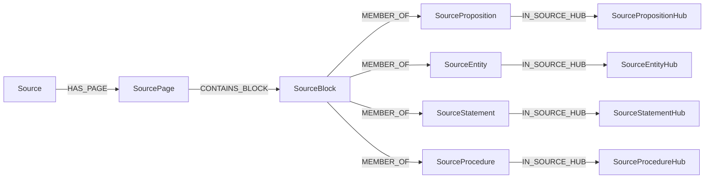

# Source semantics

KMS2 treats a source as evidence and searchable learning material, not as a
learner's argument graph. Source Processing materializes corrected, formatted,
described, and embedded source blocks. Source Pedagogical identifies exercises,
instructions, and pedagogical components; persists statement and procedure
ownership; and reconstructs complete searchable statement/procedure content.
Source Semantic independently extracts entities and propositions from source
blocks, describes entities, and groups entity, proposition, statement, and
procedure occurrences. Statement and procedure hubs consume the reconstructed
content and embeddings written by Source Pedagogical.

The proposed goal-driven learning layer is recorded in the
[teaching roadmap](TEACHING_ROADMAP.md), with a separate
[session foundation design](TEACHING_SESSIONS.md). Those documents describe
planned work; the source-stage behavior below remains the current implementation.

## Stage ownership

Source Processing persists the corrected, formatted, image-described, and
embedded source graph. Source Pedagogical is a separately runnable graph: it
loads persisted pages, discovers and splits pedagogical material, embeds only
new split blocks, reconstructs statement/procedure content, and persists the
updated block order plus instruction, statement, and procedure data. It does not
rerun OCR or source correction. Source Semantic independently extracts entities
and propositions from persisted source blocks, describes entities, then runs
local occurrence grouping.

`run_source_pedagogical_stage(settings, user_uuid, source_uuid)` runs the
pedagogical graph for a source owned by the selected user. The combined
`ingest_and_run_source_semantic_stage(...)` operation runs Source Processing,
attaches the source, then runs Source Pedagogical and Source Semantic in that
order. The TUI also exposes Source Pedagogical for existing sources.

## Explicit runtime examples

Curated demonstrations live beside their module family. Source Pedagogical
examples live in `src/kms2/module/source_pedagogical/examples/`. Each file
exposes task-specific functions such as `instruction_start_examples()` that
build a fresh `list[dspy.Example]`, including fresh nested input/output models.
Examples match the signature's fields and mark runtime inputs with
`.with_inputs(...)`.
For indexed classifiers, one example represents a complete batch request and
its expected indexed decisions.

Composition explicitly selects examples when constructing a predictor:

```python
predictors.create(
    InstructionStartRouterModule,
    source_pedagogical.instruction_finder.start_router,
    InstructionStartRouterSignature,
    examples=instruction_start_examples(),
)
```

Omitting `examples` leaves the predictor without curated demonstrations.
Supplying them attaches exactly that set, in order, to the underlying DSPy
predictor before concurrency/residency and recording wrappers are added.
DSPy's native `predictors()` discovery handles both `Predict` and
`ChainOfThought`; attachment does not assume a particular wrapper depth.
`LocalModelRuntime.predictor()` accepts the same keyword for direct local
construction. Domain-module constructors do not attach or overwrite examples.

These examples are few-shot prompt material used during regular inference,
not weight training. No optimizer, sampling, file discovery, or automatic
promotion from recordings is involved. Signature instructions contain task
rules; worked input/output demonstrations live in the explicit examples
package instead of being duplicated in prompt prose. Recorded outputs remain
separate from reviewed runtime examples.

Runtime examples have been checked through actual factory and adapter rendering
for local/subscription construction, both strategies, and recording on/off.
The remaining-stage batching cutover rendered 64 combinations across eight
changed signatures, including native-image groups, without starting local
models. Recorded Luna-low node runs passed 31 checks, including singleton/batch
membership and provenance, positive-only sparse text rewrites, logical-image
isolation, and typed native-image dataset hydration. The comparison fixtures
used 8 batched calls versus 21 singleton calls. These are small correctness
fixtures, not throughput estimates; no Neo4j data was rewritten.

## Source-processing correction batches

Visual OCR correction batches every source block, including image blocks and
blocks without OCR text. Each request contains indexed block metadata and an
ordered list of native crop images; crop ordinal matches the batch-local block
position. Returned corrected content maps directly to the original page/block.
Inputs and outputs are assumed valid and complete: there is no result repair,
fallback transcription, or defensive output-coverage validation. UUIDs, visual
assets, crop paths, page metadata, and empty pages are preserved.

The correction prompt treats each crop as authoritative and OCR text only as
a potentially faulty aid. It preserves intentional blanks, checks visible
signs and exponents, and never solves the source task. Its runtime examples
use small packaged crops under `examples/assets/`, loaded as native
`dspy.Image` inputs. They contrast blank preservation, literal OCR correction,
and a non-text figure whose corrected transcription is null. Representation
formatting remains a separate stage.

Configure `settings.source_processing.content_correction`:

- `batch_size`: maximum blocks/images per request, default 4.
- `input_token_budget`: serialized text/metadata budget, default 2048 tokens.
- `safety_margin_tokens`: model-capacity reserve, default 256.
- `inference`: the existing vision-inference settings, now nested.

Set `KMS2_SOURCE_PROCESSING__CONTENT_CORRECTION__BATCH_SIZE=1` for one block per
call. The other fields use the same environment prefix, for example
`KMS2_SOURCE_PROCESSING__CONTENT_CORRECTION__INPUT_TOKEN_BUDGET`. Inference
overrides now use `CONTENT_CORRECTION__INFERENCE__PROFILE`, etc., rather than
flat fields. Old single-block correction recordings must be regenerated for the
new indexed signature.

The shared whole-item packer bounds serialized text/metadata tokens and block
count only. Dispatch does not inspect crop dimensions or file sizes. Images are
loaded unchanged when the worker runs; there are no image-byte or pixel budgets,
resizing, or image-quality reductions.

The text budget is not a total multimodal token budget: image tokens are not
counted. The profile-aware budget retains the configured completion reserve and
safety margin, but does not guarantee image-context fitting. Oversized text
singletons raise the packer's input-budget error rather than being split,
truncated, or dropped.

Correction remains separate from formatting and shares the existing ChatGPT
concurrency limit. A live Luna smoke corrected three real textbook crops in one
batched call versus three singleton calls, retaining heading/paragraph content
and equation values, source identities, assets, and empty-page structure.

## Source-processing formatting batches

Formatting packs nonempty, non-image source blocks in source order using the
shared `pack_items()` token-budget machinery. Batches may span pages, but blocks
remain independent: the model returns each complete rewritten block with its
zero-based batch-local `position`. Exact output-position coverage is required;
missing, duplicate, and unknown positions fail instead of misattributing text.
The backend restores original page/block locations, UUIDs, and visual assets.
Images and empty blocks pass through unchanged.

Formatting demonstrations are indexed `FormattingInput`/`FormattingOutput`
batches supplied by `formatting_examples()`. They cover mathematical
representation, code and image-placeholder preservation, prices/references,
answer blanks, and prose punctuation outside math delimiters. The formatter
does not apply global delimiter replacements after inference: valid code
containing literal delimiter characters is returned unchanged. Existing
position-coverage checks remain at the formatting boundary.

Configure `settings.source_processing.formatting`:

- `batch_size`: maximum blocks per request, default 32.
- `input_token_budget`: serialized block payload budget, default 2048 tokens.
- `safety_margin_tokens`: model-capacity reserve, default 256.
- `inference`: the existing text-inference settings, now nested under formatting.

For one block per call, set `KMS2_SOURCE_PROCESSING__FORMATTING__BATCH_SIZE=1`.
Smaller token budgets also reduce batch sizes, but each whole block must fit:
an oversized singleton raises an input-budget error, never truncates or splits
the block. Input costs include serialized indexes and list overhead. The shared
profile-aware budget reserves the configured inference completion allowance and
safety margin against model capacity.

Formatting inference overrides move from `FORMATTING__PROFILE` and similar
fields to `FORMATTING__INFERENCE__PROFILE`, `FORMATTING__INFERENCE__MAX_TOKENS`,
etc., all with the existing `KMS2_SOURCE_PROCESSING__` prefix. Old single-block
formatter recordings do not match the new indexed signature; regenerate those
examples rather than mixing recording contracts.

Batching reduces model calls; it does not combine correction with formatting or
change the provider concurrency limit. A live Luna smoke formatted three blocks
across two pages in one request and the same material in three requests with
`batch_size=1`, preserving source identities and skipped blocks in both modes.

## Instruction finder batches

Instruction discovery retains its sequential cursor and source-owned spans.
Only the start and boundary classification calls are batched. Each indexed
`InstructionClassificationInput` retains its own selected before/after context
and single target; other batch items are not additional reference context.
Start and boundary context windows are unchanged and use their corresponding
model token counters independently.

The start router returns indexed `InstructionStartDecision` records; the backend
chooses the earliest positive position. A batch without a start advances the
cursor past the entire batch. Boundary batches share the active instruction's
start block and return indexed `InstructionBoundaryDecision` records. The
earliest positive boundary is exclusive and is reconsidered as a possible next
instruction start. With no boundary, scanning continues; end-of-source closes
the active instruction. An instruction contains only the shared directive and
its continuations, not the exercises it governs.

A task-specific setup is not a shared instruction. A labeled activity or
unlabeled problem with its own scenario, graph, or function is an exercise,
even when its setup says "answer the following questions" and introduces
lettered subparts. The instruction start router rejects that setup; the
instruction boundary router ends a shared directive before it. Live
demonstrations contrast these cases with directives governing independent
exercises, including examples with no surrounding context.

Configure `settings.source_pedagogical.instruction_finder`:

- `start_batch_size` / `boundary_batch_size`: default 16 items each.
- `start_input_token_budget` / `boundary_input_token_budget`: default 4096 each.
- `safety_margin_tokens`: default 256, reserved against model capacity.
- `start_router` / `boundary_router` and their context windows: existing settings.

Batch sizes apply equally to local and subscription profiles, including mixed
start/boundary selections. There is no automatic local-only singleton cap.
Model-specific token budgets still constrain how many items fit each request.

For singleton operation set both
`KMS2_SOURCE_PEDAGOGICAL__INSTRUCTION_FINDER__START_BATCH_SIZE=1` and
`KMS2_SOURCE_PEDAGOGICAL__INSTRUCTION_FINDER__BOUNDARY_BATCH_SIZE=1`.
Input budgets use the same prefix with `START_INPUT_TOKEN_BUDGET` and
`BOUNDARY_INPUT_TOKEN_BUDGET`.

The shared `pack_items()` mechanism budgets complete serialized classification
records, including each item's context and position. Boundary requests reserve
the shared start-block anchor once. Completion allowances and safety margins
are retained by the profile-aware budgets. A whole classification record must
fit; records are never truncated. At most the configured batch-size candidates
are built ahead of each cursor, rather than rebuilding the entire source suffix.
Inputs/outputs are assumed valid and complete; decisions are mapped directly
without repair or defensive result validation. Old scalar instruction-router
recordings must be regenerated for the indexed signatures.

A live Luna smoke found identical instruction member-block spans in batch and
singleton modes across a page-crossing continuation, adjacent instructions, and
end-of-source closure. Batch mode used three start and three boundary calls;
singleton mode used five start and four boundary calls. Source blocks remained
unchanged and no local router started.

## Exercise finder batches

Exercise discovery uses the instruction finder's indexed classification pattern
while retaining its own exercise semantics. Instruction-owned blocks are excluded
before creating the eligible stream, its context windows, or inference batches.
Eligible blocks remain in original source order; results map to their original
UUIDs rather than positions in the unfiltered source.

Each `ExerciseClassificationInput` carries a batch-local position, one target,
and its independently selected reference context. The start router returns
`ExerciseStartDecision` records. Boundary batches share the exercise's starting
block and return `ExerciseBoundaryDecision` records. The earliest positive
decision wins regardless of response order. Boundaries are exclusive and are
reconsidered as potential next exercise starts; end-of-source closes the current
exercise. Attached equations, images, tables, lists, and subparts remain members
when classified as continuations. Shared instructions are never exercise starts.

Exercise starts include labeled activities and unlabeled task-specific setups,
not their individual subparts. Boundary classification distinguishes semantic
transitions from page furniture: a page number or repeated running chapter or
section title keeps scanning open, whereas another exercise, a new shared
instruction, or a genuine new section ends the current span. The traversal and
context windows are unchanged. Membership remains contiguous, so intervening
page furniture remains in the span rather than being selectively removed;
source blocks are never deleted or rewritten by this classification.

A live Luna max replay of the saved five-page textbook block stream found the
11 numbered exercises plus Activity 1.2.4 as 12 exercise components, without
claiming the activity as an instruction. Exercise 8 retained its next-page
parts (e)–(f), Exercise 10 retained both next-page function conditions, and
Exercise 11 remained separate. Contrast checks retained shared-instruction
classification and a genuine new-section boundary. All source pages and
blocks remained unchanged. This finder-only replay did not repeat OCR,
embeddings, or persistence, and did not update the existing Neo4j source.

Configure `settings.source_pedagogical.exercise_finder`:

- `start_batch_size` / `boundary_batch_size`: default 16 each.
- `start_input_token_budget` / `boundary_input_token_budget`: default 4096 each.
- `safety_margin_tokens`: default 256.
- Existing `start_router`, `boundary_router`, and per-router context windows remain.

For singleton operation set both
`KMS2_SOURCE_PEDAGOGICAL__EXERCISE_FINDER__START_BATCH_SIZE=1` and
`KMS2_SOURCE_PEDAGOGICAL__EXERCISE_FINDER__BOUNDARY_BATCH_SIZE=1`. Input budgets
use that prefix with `START_INPUT_TOKEN_BUDGET` and `BOUNDARY_INPUT_TOKEN_BUDGET`.
The same settings apply to local, remote, and mixed-profile selections.

Whole serialized records, including per-item context and indexes, are packed by
the shared `pack_items()` mechanism. The boundary's shared anchor is budgeted
once, with profile-aware completion and safety reserves retained. Candidate
construction is bounded by batch size; inputs/outputs are assumed valid and
complete, with direct mapping and no repair or defensive output validation.
Old scalar exercise-router recordings must be regenerated.

A live Luna smoke retained identical exercise memberships in both modes,
excluding two instruction-owned blocks and keeping an equation/subpart
continuation across a page boundary. Batch mode used two start and two boundary
calls; singleton mode used three start and four boundary calls. Original source
blocks remained unchanged. Exercise and pedagogical discovery remain separate phases.

## Pedagogical finder batches

Pedagogical discovery uses the same indexed start/boundary batching pattern.
It excludes the union of instruction-owned and exercise-owned block UUIDs before
building the eligible stream, per-item contexts, or inference batches. Surviving
blocks retain their original order and UUIDs, including across page boundaries.
Source pages and blocks are never rewritten by discovery.

Each `PedagogicalClassificationInput` has a local position, a single target, and
its own before/after context. Start and boundary routers return typed indexed
decisions; the earliest positive wins regardless of response order. Boundary
requests share the component's start block. A boundary is exclusive and is
reconsidered as a possible next start; no boundary before end-of-source closes
the active component over the remaining eligible blocks.

Definitions, theorems, worked examples, and prescribed procedures retain their
existing classification semantics. Attached equations and numbered procedure
steps can continue a component; they are not automatically separate components.
Each item's reference context is independent of other items in the request.

As with exercise discovery, page numbers and repeated running titles do not
close an active pedagogical span. Genuine section transitions and distinct
components do. Each step/subpart example includes its own parent context;
another item in the same batch is never a substitute for that context.
Intervening layout blocks can remain in the contiguous membership span.

Configure `settings.source_pedagogical.pedagogical_finder`:

- `start_batch_size` / `boundary_batch_size`: default 16 each.
- `start_input_token_budget` / `boundary_input_token_budget`: default 4096 each.
- `safety_margin_tokens`: default 256.
- Existing router inference and per-item context-window settings remain unchanged.

For singleton operation set both
`KMS2_SOURCE_PEDAGOGICAL__PEDAGOGICAL_FINDER__START_BATCH_SIZE=1` and
`KMS2_SOURCE_PEDAGOGICAL__PEDAGOGICAL_FINDER__BOUNDARY_BATCH_SIZE=1`. Input-token
budgets use that prefix with `START_INPUT_TOKEN_BUDGET` and
`BOUNDARY_INPUT_TOKEN_BUDGET`. Local, remote, and mixed profiles use the same
settings. Whole serialized items are packed with `pack_items()`; the shared
boundary anchor is budgeted once, and profile-aware completion/safety reserves
are retained. Inputs and outputs are assumed valid and complete, without repair
or defensive output validation. Old scalar router recordings must be regenerated.

A live Luna smoke produced identical memberships in batch and singleton modes,
excluding both owner families, retaining a definition/equation continuation across
pages, and grouping a procedure with its numbered steps. Batch mode used two
start and two boundary calls; singleton mode used three start and five boundary
calls. Source blocks remained unchanged and no local router started.

## Exercise split routing batches

Exercise split routing uses the shared context window with a target-count cap.
Each window makes one router call over indexed `PositionedSourceBlock` targets,
returning one `SplitRouteDecision` per target. Before/after blocks are reference
context, never candidates. A target qualifies only when it packs multiple
independent numbered exercises; numbered procedure steps remain one procedure.

Positive decisions retain their original target-local positions when passed to
the existing batched splitter. They are not renumbered after filtering. The
backend adds the window's absolute start position to map replacements to source
blocks; unselected blocks remain unchanged. No positive decisions means no
splitter call. Windows may cross pages, but collection preserves page/block order.
Inputs and outputs are assumed valid and complete; there is no repair or
defensive output validation.

Configure `settings.source_pedagogical.exercise_splitter`:

- `batch_size`: maximum target blocks per window, default 32.
- `context_window.target_budget`: target content-token budget, default 2048.
- `context_window.backward_budget` / `forward_budget`: existing optional context
  budgets, unchanged.
- `router` / `splitter`: existing separate text-inference settings, unchanged.

Use `KMS2_SOURCE_PEDAGOGICAL__EXERCISE_SPLITTER__BATCH_SIZE=1` for singleton
windows. Target-budget overrides use
`KMS2_SOURCE_PEDAGOGICAL__EXERCISE_SPLITTER__CONTEXT_WINDOW__TARGET_BUDGET`.
A zero target budget also retains one initial target per window. The token budget
counts block content using the conservative maximum across router and splitter
tokenizers; it is not a count of the complete serialized prompt. Single blocks
are indivisible, so an initial target is retained even if it exceeds that budget.

The shared `select_window(max_targets=...)` limit stops expansion before selecting
context-after. The cursor advances past every selected target, avoiding overlap
or skipped targets. Router signatures and demonstrations now use indexed lists;
old single-target router recordings must be regenerated.

A live Luna smoke routed a prose block, a packed exercise block, and a numbered
procedure across two pages. Batched mode used one routing call and one splitting
call; singleton mode used three routing calls and one splitting call. Both
produced the same two exercise fragments and left prose/procedure blocks intact.

Splitter examples obey the exact-character contract: separator whitespace at
a split belongs to the preceding piece, so concatenating all pieces restores
the original candidate. Leading continuation fragments remain intact, and
lettered subparts stay with their parent exercise. Router demonstrations
distinguish a procedure with its own lead-in from multiple independent tasks.

## Statement and procedure classification

Role classification uses each complete component's content, not mathematical
notation alone. A bare task expression is a statement; visible working or a
standalone proof/solution is a procedure; a component containing both has both
roles. Exercises bypass inference and become full exercise statements.

Each packet contains independent `PedagogicalComponentInput` records. Outer
`position` identifies the component within the packet; member positions start
at zero within each component. Only mixed components reach statement/procedure
partitioning, independently packed for the two calls. A member may belong to
both partitions. Statements retain source ordering, including exercises;
procedures retain original component traversal order.

Configure `settings.source_pedagogical.statement_procedure` with
`role_batch_size`, `statement_batch_size`, and `procedure_batch_size` (16 each),
their corresponding `*_input_token_budget` fields (4096 each), and
`safety_margin_tokens` (256). The existing three inference settings remain
separate, including independent profile/tokenizer selection. Set all three
count limits to 1 for singleton operation. Composition explicitly supplies
`pedagogical_role_examples()`, `statement_partition_examples()`, and
`procedure_partition_examples()`; demonstrations keep both index scopes local.

## Instruction governance batches

Each call shares one instruction anchor and judges independently contextualized
complete exercise statements. Candidate domains and cursor advancement remain
start-based and sequential; rejected candidates still consume their source span.
Accepted local positions map back to original statement UUIDs in request order.
Every instruction receives a freshly computed governed list, including an empty
list when no candidate qualifies. Source blocks and memberships are unchanged.

Configure `settings.source_pedagogical.instruction_governance` with `batch_size`
(16), `input_token_budget` (4096), and `safety_margin_tokens` (256). Its inference
and 200-before/500-after context window remain unchanged. A packet never shares
multiple instruction anchors, and each item's context is its own reference
evidence. `instruction_governance_examples()` supplies contrasting candidates
under shared anchors.

## Logical image description batches

Descriptions batch logical image blocks, not individual assets. Each indexed
item addresses its ordered assets in a top-level native `target_images` list.
One two-asset block receives one description; an existing image block with no
assets is still an item with an empty reference list. Each item retains its own
200-before/200-after context. Workers load files, restore original ownership,
and change only block content; UUIDs, crops, assets, and page order survive.

Image descriptions preserve source-associated variable labels and units and
distinguish open/filled markers and separate branches. Unannotated graph
locations remain qualitative: the descriptor does not calculate coordinates
or transcribe numeric axis ticks. Explicit point annotations can be copied.
The native image remains authoritative for detailed chart reading. This avoids
turning a low-effort vision misreading of a non-unit scale into false numeric
source evidence. Runtime demonstrations contrast explicit point annotations,
contextual units, identified panels, and an unidentifiable panel.

Configure `settings.source_processing.image_description` with `batch_size`
(4), `input_token_budget` (2048), and `safety_margin_tokens` (256), alongside
its existing inference/context settings. `image_description_examples()` uses
packaged native images to contrast a split grid with an unrelated triangle.

## Text and image seam batches

Seams still run an even pass, collection, then an odd pass over the collected
pages. Candidate page indexes must be physically adjacent, not merely adjacent
in a selected-page list: `[0, 2, 3, 5]` has only seam `(2, 3)`. Existing edge
eligibility and nearest structural reference-context selection remain unchanged.
Independent same-parity candidates are packed into existing worker dispatches.

Text workers judge a packet once and send only positive decisions for rewriting.
Rewrite positions retain their original judge-packet values, including gaps.
Rejoining changes only the upper tail's content and removes the selected lower
head; negative pairs are not rewritten. Reference context is never inserted.
Image workers use a top-level native `seam_images` list with paired references;
a positive appends lower assets after upper assets, keeps upper provenance, and
removes only the lower edge block. A merged multi-asset image remains one target
for the subsequent description stage.

Configure `settings.source_processing.text_seam` with `judge_batch_size` /
`rewrite_batch_size` (16 each), `judge_input_token_budget` /
`rewrite_input_token_budget` (4096 each), and `safety_margin_tokens` (256).
Judge and rewriter inference remain separate. Configure
`settings.source_processing.image_seam` with nested `inference`, `batch_size`
(4), `input_token_budget` (2048), and `safety_margin_tokens` (256). Image-seam
inference environment overrides now use
`KMS2_SOURCE_PROCESSING__IMAGE_SEAM__INFERENCE__PROFILE` (and corresponding
inference fields); limits use `...__IMAGE_SEAM__BATCH_SIZE`, etc. Old flat
inference keys are not aliases.

All remaining-stage limits apply identically to local and subscription profiles.
Setting a count limit to 1 forces singleton calls. Whole requests include their
own context in compact JSON costs, reserve shared envelopes once, and use
conservative local-index widths. Oversized atomic requests raise
`InputBudgetExceeded`; components and context are never truncated. Empty work
does not tokenize or call inference. These budgets estimate application text
and metadata only, not signature/demo overhead or native vision tokens; no
image byte/pixel budget or full multimodal fitting guarantee is introduced.

The eight changed call types have explicitly selected typed runtime examples.
New native-image examples use packaged, purpose-drawn assets. Old scalar
recordings are retained as history but are incompatible with the new signatures;
record new runs rather than loading or repairing them as current examples.
Inputs and typed outputs are assumed complete and valid: indexes map directly
to node-owned requests without coverage checks, repair, fallback, or extra
retries. Provider concurrency/retry policies, graph channels, application APIs,
and persistence contracts are unchanged.

## Entity indexing and semantic hubs

Source Semantic extracts entity occurrences independently from propositions,
persists them, then generates entity descriptions and embeddings before local
hub reconciliation. It does not construct the later learning proposition graph.
Entity extraction, descriptions, embeddings, and their runtime examples, nodes,
and phase registrations live in `source_semantic`. Hub models, judges, examples,
nodes, and phase registration also live in `source_semantic`.
`SourceEntityRepository` and its Cypher remain under `database/source/`. Shared
extraction models and request construction are stage-neutral:
`core/model/source_extraction.py` and `node/source_extraction.py`.

Configure entity indexing through `settings.source_semantic`:

- `source_entity_extraction`: extraction inference.
- `source_entity_context_window`: extraction target and reference budgets.
- `source_entity_description`: inference, context, and description batching.

Configure entity reconciliation through
`settings.source_semantic.source_entity_hubs`: candidate, reranker, context, and
identity-judge budgets. The reconciliation algorithm is unchanged.

`SourceSemanticStageResult` reports entity occurrence, description, and hub
counts. `SourceProcessingStageResult` reports source-processing page counts.
Entity occurrences are extracted and described as part of Source Semantic.

Entity occurrence embeddings are vector-indexed before any hubs exist. The
entity index supports evidence retrieval for a future learning proposition
graph; semantic ingestion does not construct that graph. The existing
hub-search repository API requires hub generation. Reconciliation and hub
search remain source-scoped, not global identity resolution. Moving hub
creation does not delete previously persisted hubs.

## Extraction and evidence

Each extraction stream packs consecutive source blocks into token-bounded,
non-overlapping targets with separate before/after reference context. The cursor
advances past the complete target, so each source block is targeted once per
stream. `select_window()` and token counting are shared with existing source
processing; no second window-selection system is introduced.

Target blocks are projected as `PositionedSourceBlock` records containing
`position` and `source_block`. Positions are contiguous, zero-based, and reset
for each request. Every extracted candidate returns one required
`source_position`, selecting exactly one target block as its owner. Out-of-range
positions are rejected at the extraction-result boundary; context cannot be
selected as ownership.

The owning block must state the claim or mention/discuss the entity. Other target
blocks and before/after context may resolve pronouns, notation, names, and
assumptions, but cannot contribute unrelated independent claims to that owner.
Extraction windows are transient request data. Collectors retain each occurrence's
owning block, not references to the other target/context blocks. Later consumers
select their own surrounding context from the canonical source-block stream.

- A proposition is a self-contained reusable claim. It preserves domains,
  assumptions, exceptions, negation, quantifiers, and mathematical conditions.
  Unresolvable references are not invented. A proposition needs neither a proof
  nor a matching entity to be retained.
- An entity is an explicitly discussed concept, named result, structure,
  algorithm, object, or meaningful named person/organization. Substantive
  headings can yield entities even when they assert no proposition. Consolidate
  mentions of the same entity within one block, including supported aliases,
  into one occurrence; extract another occurrence if another block mentions it.
  Entity extraction is not gated by proposition extraction. Entity identity is
  an inference responsibility, not a fuzzy backend deduplication step.

Proposition admission distinguishes asserted mathematical claims from requested
constructions and local task requirements. Conditions listed under a graphing
exercise are not evidence that a function with those properties exists.
General rules explicitly supplied in hints are eligible independently of
surrounding question clauses; the task is not to solve those questions.
Composition supplies `source_proposition_extraction_examples()` with contrasting
requested constructions, asserted existence, and mixed question/hint evidence.

`SourceProposition` and `SourceEntity` occurrences each have exactly one owning
source block. `SourceStatement` and `SourceProcedure` occurrences connect to
every contributing source block. All four use `SourceBlock → MEMBER_OF →
occurrence`. There are no direct document-Source-to-occurrence edges,
target/context pointer vertices, per-block context relationships,
context-boundary relationships, or context-window reference properties. The
source's existing `NEXT_BLOCK` chain provides ordering for transient context
selection.



Source scope is derived from page/block ownership for all four occurrence types
and their local hubs; no occurrence or hub node persists `source_uuid`. Runtime
extraction occurrences may carry the derived UUID only as transient job context.
Only extraction requests retain extraction-window context. Occurrences in
different source blocks remain distinct even when their content matches.
Collectors order by owning source block, retaining model output order within a
block, regardless of worker completion order. Reloads derive owner order from
`FIRST_BLOCK`/`NEXT_BLOCK` and use occurrence UUID as the within-block tie-break.
Worker, batch, and group ordinals remain transient fan-in bookkeeping; they are
not occurrence properties.

`SourceExtractionInput` carries positioned targets without database identities.
The shared `SourceEvidenceInput` contract carries one unindexed owning target
block and ordered, unindexed before/after reference context. Descriptions,
entity identity judging, and learning use this UUID-free evidence. Positions
select ownership during extraction; persistent UUID mapping belongs to nodes.

Both extraction streams default to 2048 target tokens, 1024 backward reference
tokens, and 1024 forward reference tokens, but now have independent settings.
Propositions use `KMS2_SOURCE_SEMANTIC__CONTEXT_WINDOW__TARGET_BUDGET`,
`BACKWARD_BUDGET`, and `FORWARD_BUDGET`. Entities use the corresponding fields
under `KMS2_SOURCE_SEMANTIC__SOURCE_ENTITY_CONTEXT_WINDOW__`.
Entity-description reference windows remain separate. Statement and procedure
reconstruction use their explicit owning source blocks; statement requests also
include blocks from instructions governing that statement.

### Transient consumer context

Descriptions, entity identity judging, and atomic learning select their own
reference blocks through the existing `select_window()` machinery. The owning
block is the fixed target; context budgets never expand ownership. This does not
require persisted window references or a second context-selection system.

- Entity descriptions retain
  `settings.source_semantic.source_entity_description.context_window`.
- Entity identity judgments use
  `settings.source_semantic.source_entity_hubs.context_window`, defaulting to
  400 tokens before and 400 after, counted with the judge's configured tokenizer.
- Atomic learning uses `settings.source_learning.context_window`, also defaulting
  to 400 before/400 after with the atomic inference tokenizer.

The learning repository returns the owning block and provenance only.
`SourceAtomicFlashcardNode.load()` loads canonical source blocks and assembles
the transient model evidence. `SourceAtomicFlashcardRequest.source_block_uuid`
is a backend anchor, excluded from the UUID-free `model_input()`.
Entity-hub members likewise carry a backend-only owner UUID; initialization
assembles their judge evidence before reconciliation starts.

Zero budgets yield no reference blocks while retaining the owner. Changing a
consumer's budgets can change later inference inputs; the graph does not promise
replay of an earlier extraction window. Optional inference recordings retain
the actual content supplied to a model, rather than turning those request
windows into graph topology.


Previously generated multi-block occurrence ownership and extraction recordings
without `source_position` do not satisfy this contract. Re-extract affected
sources to replace their generated streams; there is no automatic ownership
guessing, legacy-recording repair, or migration of retained experimental data.

## Reconstructed statement and procedure content

Source Pedagogical reconstructs each statement and procedure from its original
source-block evidence. Requests preserve source order and use only their member
blocks. A statement also receives the blocks of every instruction that governs
it; each governed statement gets its own request containing that instruction.
A procedure reconstruction uses only its own member blocks. It does not inherit
a governed statement's instruction blocks.
These inputs do not expand to adjacent reference context.

The reconstructed content and its embedding are persisted with the owning
statement or procedure. Their source scope is derived through page/block
ownership, not persisted as a `source_uuid` property. The original source
blocks, membership, governance, page order, and visual assets remain unchanged.
A statement or procedure has one source-block owner set; the reconstruction is
searchable content, not a replacement for that provenance.

Source Semantic does not generate occurrence descriptions or occurrence
embeddings for statements and procedures. Candidate retrieval, pair judgment,
hub synthesis, and hub embedding consume the reconstructed content and its
stored vector. Semantic persistence does not overwrite statement/procedure
content or embeddings. Entity descriptions and entity embeddings remain part of
the existing Source Semantic flow.

Configure `settings.source_pedagogical.source_statement_reconstruction` and
`settings.source_pedagogical.source_procedure_reconstruction`. Both use
`MaterialReconstructionSettings`:

- `batch_size`: maximum complete reconstructions per request, default 16.
- `input_token_budget`: serialized application-payload budget, default 4096.
- `safety_margin_tokens`: model-capacity reserve, default 256.
- `inference`: no-retry text-inference settings.

For singleton statement calls, set
`KMS2_SOURCE_PEDAGOGICAL__SOURCE_STATEMENT_RECONSTRUCTION__BATCH_SIZE=1`.
Procedure settings use the corresponding `SOURCE_PROCEDURE_RECONSTRUCTION`
prefix. Each stage has independent batch, budget, margin, and inference
configuration. Budgets use the stage tokenizer and completion/capacity reserves;
signature and demonstration overhead is not counted by the payload estimate.

The whole-item packer bounds serialized request tokens and item count. It does
not truncate or split source blocks. An oversized singleton raises
`InputBudgetExceeded`; empty work skips tokenization and inference. Inputs and
typed outputs are assumed valid and complete, and indexed output content maps
directly back to its target draft without repair or fallback.

Explicit demonstrations live in
`module/source_pedagogical/examples/source_statement_reconstruction.py` and
`source_procedure_reconstruction.py`. They show source-grounded reconstruction
of complete statements and ordered procedures. Entity description and identity
examples remain in `module/source_semantic/examples/`.

Entity descriptions still use independent complete requests and the shared
whole-item packet machinery. Each entity retains its single owning block and
selects its configured transient context window; statement/procedure
reconstruction uses the exact member and governing-instruction blocks described
above, not those entity context windows.

## Local hubs

Proposition and entity hubs are identity-only containers: their only durable
property is `uuid`, with incoming `IN_SOURCE_HUB` relationships from original
occurrences. Source scope is derived through page/block membership and then
`occurrence → IN_SOURCE_HUB → hub`;
it is not duplicated as a hub property. Names, statements, descriptions, aliases,
and embeddings are not copied or synthesized onto these hubs. Occurrence text,
descriptions, embeddings, and source-block ownership remain intact.

Entity hubs use iterative group-level reconciliation:

1. Start every occurrence in a singleton group.
2. Retrieve candidate groups through their members' embeddings. Score a group
   pair by its best member cosine, excluding the query group before ranking.
   Apply `candidate_limit` to distinct groups **per query group**, then
   canonicalize and deduplicate bilateral proposals.
3. Expand proposed group pairs into all cross-member occurrence pairs. Reuse
   already known pair decisions. Rerank previously unexamined pairs using names
   and descriptions; reranking can reject, but never approve, identity.
4. Explicitly judge every reranker survivor with its own ordered, UUID-free
   source evidence, selected transiently using the identity judge's context
   budgets. Shared spelling, topic, and generic descriptions do not establish
   identity. Independently defined exercise-local functions can remain separate
   while a general concept can be shared across exercises.
5. Merge only groups whose every cross-member pair has a positive judgment.
   Select nonconflicting merges from the round's snapshot in descending
   candidate-score order, with stable UUID tie-breaking.
6. Rediscover candidates for the current groups after merging. Stop when a
   round makes no merge.

Positive judgments, negative judgments, and reranker rejections are cached by
unordered occurrence pair within this invocation. Unknown pairs do not authorize
a merge. Reducer-backed worker outputs are cleared between rounds using
LangGraph's `Overwrite`; upstream processing histories are not replayed.
An internal worker subgraph uses a member-count-derived execution-step bound:
each merging round reduces the number of groups, so no arbitrary round cap is
needed.

Final groups form a partition: exactly one hub per occurrence, including
singletons, with no overlaps or duplicate membership sets. Entity grouping no
longer materializes `SIMILAR_TO` edges or invokes GDS/SLLPA. Candidate discovery
computes source-local member-pair scores each round; its work can be quadratic
in source size, and strict cross-member judging can be costly for large groups.
Statement/procedure grouping algorithms are unchanged; their judgment and
synthesis evidence is now the full reconstructed occurrence content.

Proposition hubs use a narrower contract: members must express the same claim.
Paraphrases and consistent renaming of arbitrary variables may qualify; changed
assumptions, domains, quantifiers, negation, fixed constants, or implication
strength/direction do not.

Vector retrieval nominates bounded candidates; reranking can reject them but
cannot approve membership. Every surviving pair requires an explicit positive
model judgment. Groups are disjoint and use deterministic complete-link merges:
every cross-group pair must have been approved. An absent or negative comparison
prevents a merge, so an A–B–C bridge cannot silently authorize A/C equivalence.
Missed candidates remain separate searchable hubs; this is not an exhaustive or
formal mathematical-equivalence procedure.

Neither hub type requires a synthesis, summary-reduction, or hub-embedding call.
Proposition grouping still operates on original statements; it does not rewrite
variables or generate premises/conclusions. Hubs remain source-local and are
rebuilt by source replacement, not incrementally reconciled across sources.

## Independent search

Proposition and entity occurrences and their hubs remain independent. There is
no proposition/entity association stage or stored cross-link between these
streams. Entity extraction and search do not depend on propositions, and source
learning does not consume entity descriptions.

`SourcePropositionRepository.search_source_proposition_hubs` and
`SourceEntityRepository.search_source_entity_hubs` accept a source UUID, nonempty
query embedding, and positive `top_k`. Each requested source's hub is scored by
the maximum exact cosine similarity among its embedded members. Equal-scoring
members are resolved by member UUID; hubs rank by score, then hub UUID.
Grouping precedes `top_k`, so multiple matching members do not consume multiple
result slots for one hub. The requested Source node's ownership relationships
select members and their hubs; unrelated sources cannot consume a global ANN
result limit. Search-result source UUIDs are derived from that matched Source.

Each result carries the hub UUID, best-matching member UUID, original member
text (or entity name and description), source UUID, owning target-block UUIDs,
and score. This is query-specific evidence, not an authoritative hub summary.
The search API computes exact member scores rather than using a hub vector
index. Its work scales with the source's embedded memberships. Search is a
repository API, not a separate terminal action.

## Execution and ownership

Source Semantic extracts propositions and entities from persisted source
blocks, generates entity descriptions, and runs local hub processing. Statement
and procedure content/embeddings are already persisted by Source Pedagogical;
their hub stages read that material without rewriting it. Proposition and entity
extraction remains independent of the pedagogical occurrence streams.

`SourceSemanticSourceLoadNode` is the sole writer of the shared `blocks` state.
Downstream nodes read that snapshot and return only their own outputs.
The block list uses ordinary replacement semantics, not a first-nonempty-wins
reducer; parallel branches do not merge or republish source blocks.

Source-owned replacement is destructive within that source's generated output.
Replacing proposition occurrences removes their previous occurrences, evidence
relationships, corresponding hubs, and dependent cards/reviews, including when
the new output is empty. Replacing entities removes their occurrences, evidence
relationships, and hubs without deleting proposition-derived cards or reviews.
Neither stream replaces the other extraction stream or canonical source blocks.

Replacing source structure removes its local semantic artifacts before rebuilding
the block chain. Hubs are discovered and removed before their member occurrences,
while those ownership paths still exist. Other sources remain untouched.
Schema definitions no longer create target/context pointer constraints,
proposition/entity hub vector indexes, or hub source-UUID indexes. No stored-data
cleanup or migration runs during schema initialization; existing database
contents are left alone.

Structural schema initialization explicitly declares the `SIMILAR_TO` relationship
type and `score` property key required by retained native GDS projections, even
when no accepted relationship has ever existed. It does not fabricate edges or
change statement/procedure grouping.

The application owns resource lifetime and source ownership checks. Composition
constructs dependencies; inference nodes do not write directly to Neo4j.
Repositories own persistence and source-local search. DSPy modules accept injected
predictors; composition selects their named local or subscription backend.

## Inference profiles and ChatGPT subscriptions

The configured text default is `chatgpt-luna`. All text stages, including
source-learning cards, follow `settings.llm.default_text_profile` unless their
own inference settings specify a `profile`. Vision stages (content correction,
image seam, and image description) explicitly default to `chatgpt-luna` too.
Changing the text default alone does not change those explicit vision selections;
each remains independently overridable, including with `gemma-vision-8k`.
Stage selection uses `profile`, not the removed stage-level
`model_server_profile` field. Embeddings default to OpenRouter Voyage 4 Large, and
reranking defaults to Voyage `rerank-3-lite`; local profiles remain opt-in.

`settings.llm.profiles` is a discriminated registry. A `local` profile references
a separately configured llama.cpp `model_server_profile`; the existing
`settings.local_models.router.model_server_profiles` still owns model files and
server load parameters. A `chatgpt` profile owns its subscription model,
reasoning effort, input/context limits, and token-estimation encoding. The first
subscription profile is `chatgpt-luna`, using `chatgpt/gpt-6-luna` with low
reasoning effort through LiteLLM's Responses provider.

Luna vision was exercised through the actual image-description module using a
generated image: the live response correctly identified a blue triangle and a
red circle, without starting a local router. DSPy supplies native image content
through the same subscription Responses provider used by text inference. Text
and vision predictors from a factory share its configured ChatGPT concurrency
limit.

Authenticate explicitly from a foreground terminal:

```bash
uv run kms2 --login-chatgpt
```

Follow the device authorization URL and code printed by LiteLLM. Device-code
login must be allowed by the ChatGPT account or workspace. Login does not require
a KMS user, database, or local model files. LiteLLM owns token storage and refresh
in `~/.config/litellm/chatgpt/auth.json`, or its configured `CHATGPT_TOKEN_DIR` /
`CHATGPT_AUTH_FILE` location. The login operation restricts the directory to
`0700` and credential file to `0600`. Never commit, log, or share the credentials.
The login belongs to the operator's subscription, not to each KMS learning user.

Select Luna for one invocation:

```bash
uv run kms2 --llm-profile chatgpt-luna
```

The TUI's **Select text inference profile** action changes the default for the
same invocation. For an environment-configured default and a local stage
override, use:

```bash
KMS2_LLM__DEFAULT_TEXT_PROFILE=chatgpt-luna uv run kms2
KMS2_LLM__DEFAULT_TEXT_PROFILE=chatgpt-luna KMS2_SOURCE_SEMANTIC__SOURCE_PROPOSITION_EXTRACTION__PROFILE=gemma-text-32k uv run kms2
```

Nested profile settings can be overridden, for example
`KMS2_LLM__PROFILES__CHATGPT-LUNA__REASONING_EFFORT=medium`. Because that variable
contains a hyphen, set it using `env 'NAME=value' ...` rather than shell assignment
syntax. Explicit unknown profiles and mixed provider options are errors, not
reasons to fall back to local inference.

Authentication preflight examines only the requested stage's resolved profiles.
Missing/revoked credentials, quota exhaustion, and provider failures propagate;
an asynchronous worker never starts a human device login. Re-run the explicit
login command if the provider requires reauthorization. The subscription model
must be available to the signed-in account and workspace.

ChatGPT requests do not acquire the GPU residency lock. Predictors from one
graph's factory share a semaphore configured by `KMS2_LLM__MAX_CONCURRENCY`
(default 4). OpenRouter embedding and Voyage reranking requests each have their
own independent semaphore (default 4); independent requests across all three
providers can overlap. Graph dependencies still determine when dependent stages
run; entity reconciliation has round barriers, and the remaining semantic hub
families run serially.

The local router starts only when local LLM inference is used. Local text,
vision, embedding overrides, and explicit local reranking retain exclusive
GPU-role switching. Hosted requests do not load another local GPU model.

Remote windows and payload budgets use the profile's explicit `o200k_base`
encoding estimate, not a local Qwen/Gemma tokenizer. This is not an authoritative
GPT-6 token count. Application budgets reserve completion space and safety
margins within the selected profile's input/context limits. The subscription
backend does not enforce client-supplied output-token caps: stage `max_tokens`
is only a budgeting reserve there. Local sampling settings and token caps are
not sent to ChatGPT. Existing retry counts, typed DSPy parsing, response caching,
and optional recording remain; no custom output-repair or retry layer is added.

Configured DSPy language models use `cache=True`. Native DSPy memory and disk
caches reuse identical complete LM requests across runs; they are not a
per-source-block or whole-stage cache. Changing instructions, demonstrations,
context, or any item in a batch changes that request's key. Revised image
descriptions can therefore invalidate later extraction windows and description
batches even when most source text is unchanged. Cached LM responses still
pass through normal typed parsing and recording; no output-repair layer is
introduced. OCR is a separate provider and is not covered by DSPy's LM cache.

## Embedding providers

Embeddings default to OpenRouter's `voyageai/voyage-4-large`, through LiteLLM's asynchronous
embedding API. Set `KMS2_EMBEDDING__API_KEY` in the process environment to your
OpenRouter API key; it is separate from ChatGPT subscription authentication and
OpenRouter embedding usage is separately billed. The key is represented as a
secret setting. Never commit it, print it, or paste it into chat. A missing or
empty key is an error, not a reason to fall back to local inference.

One embedding client is shared across source-processing and source-semantic
stages in an application invocation. It packs ordered inputs by item count and
token budget, runs bounded batch workers, and restores input ordering using the
provider's response indexes. Concurrent `embed()` calls share the same limit.
Invalid indexes, missing/duplicate results, and wrong vector dimensions fail at
the provider boundary rather than producing fabricated embeddings.

Processing, entity, and proposition embedding each run as one ordinary async
graph node, matching statement/procedure embedding in Source Pedagogical.
Each node supplies an ordered list to the shared embedding client; this is not
one provider request per item. Provider item/token budgets and shared concurrency
remain inside that client. Processing reuses `embed_source_pages` to preserve
existing vectors and embed only blocks without vectors. Entities retain their
name-description inputs; propositions retain their full-text inputs.

These single-batch phases have no LangGraph worker dispatch, collector, or
additive embedding-result reducer. Each writes its output channel directly,
then hands off to its existing persistence node. Empty work makes no embedding
request, and operational failures propagate without an unembedded-data fallback.
Multi-packet extraction/reconstruction reducers and hub-round resets are
unchanged.

Configuration:

- `KMS2_EMBEDDING__BACKEND`: `openrouter` (default) or explicit `local`.
- `KMS2_EMBEDDING__MODEL`: `voyageai/voyage-4-large`, the supported hosted model.
- `KMS2_EMBEDDING__MAX_CONCURRENCY`: default 4.
- `KMS2_EMBEDDING__BATCH_SIZE`: default 32 texts.
- `KMS2_EMBEDDING__BATCH_TOKEN_BUDGET`: default 8192 aggregate tokens.
- `KMS2_EMBEDDING__TIMEOUT_SECONDS`: default 120.
- `KMS2_EMBEDDING__TOKENIZER_PATH`: optional Voyage 4 Large tokenizer JSON path.

Hosted token counting uses Voyage 4 Large's tokenizer with special tokens, no
padding, and no truncation. Without an explicit path, its tokenizer is
fetched/cached from `voyageai/voyage-4-large` on Hugging Face. Each input is
limited to 32,000 tokens independently of the configured aggregate batch budget;
the default aggregate budget remains 8192, not the model's larger context limit.
Local selection retains the configured local embedding tokenizer, files, server
settings, and GPU ownership.

Hosted Voyage vectors use the default 1024 dimensions; local Qwen uses
4096. Index and stored-vector dimensions are checked before vector-index
initialization. Incompatible data/indexes require explicit re-embedding and
index rebuilding; no automatic deletion or dimension conversion is performed.
Even equal dimensions do not make different model spaces interchangeable:
indexing and querying must use the same embedding model. Evaluate similarity
thresholds after changing models. Learning-only operations use structural schema
and do not require an embedding key or start an embedding client.

Voyage 4 Large replaces BGE-M3; their equal dimensions do not imply compatible
vectors. Re-embed old BGE-M3 material before searching it with Voyage queries or
mixing it with Voyage output. Dimension checks cannot detect a same-width model
change. No automatic database cleanup, migration, or re-embedding is performed.

A live OpenRouter smoke embedded three inputs into three 1024-dimensional
vectors in 0.646 seconds (embedding request only). The tokenizer counted 13, 11,
and 10 input tokens. A paraphrase pair scored cosine 0.7561 versus 0.1643 for an
unrelated passage. This is transport/tokenizer/model smoke evidence, not a
retrieval-quality benchmark. Concurrency remains 4, batches remain at most 32
texts and 8192 aggregate tokens, and the separate `rerank-3-lite` selection is
unchanged. Provider model/limit sources:
[OpenRouter](https://openrouter.ai/api/v1/models/voyageai/voyage-4-large/endpoints),
[Voyage embeddings](https://docs.voyageai.com/docs/embeddings), and
[Voyage tokenization](https://docs.voyageai.com/docs/tokenization).
Ruff formatting/lint passed, and the KMS2 regression suite passed with 313 tests
and four opt-in Neo4j integration skips. The changed input-limit test accepts
32,000 tokens and rejects 32,001; tokenizer verification preserves special-token
counts without padding/truncation.

## Reranking providers

Reranking defaults to Voyage AI's `rerank-3-lite`. Set
`KMS2_RERANKER__API_KEY` to your Voyage key in the process environment or an
uncommitted local `.env` file. The secret is independent of OpenRouter keys and
ChatGPT subscription authentication. Missing credentials fail explicitly; there
is no automatic local fallback. Semantic processing requires the reranker for
hub reconciliation. Ingestion-only and learning-only operations do not construct
a reranker or require its credentials/tokenizer.

Configuration:

- `KMS2_RERANKER__BACKEND`: `voyage` (default) or explicit `local`.
- `KMS2_RERANKER__MODEL`: `rerank-3-lite`, currently the supported hosted model.
- `KMS2_RERANKER__MAX_CONCURRENCY`: default 4, shared across concurrent calls.
- `KMS2_RERANKER__TIMEOUT_SECONDS`: default 120 per HTTP request.
- `KMS2_RERANKER__TOKENIZER_PATH`: optional Voyage tokenizer JSON path.

The application owns one pooled asynchronous Voyage client per semantic
invocation. Combined ingestion/semantics reuses that client across its stages.
All hub nodes receive the provider-neutral `RerankerClient`; nodes neither
select providers nor acquire hosted-client lifetime.
Voyage requests use its HTTP API directly because the installed LiteLLM 1.106.5
rerank adapter drops the provider's `truncation` parameter. Every request sends
`truncation: false`; no hidden shortening, retries, or score conversion is added.
Voyage dashboard keys use `api.voyageai.com`; MongoDB-issued `al-` keys use
`ai.mongodb.com`.

Token counting loads/caches the model's published
`voyageai/rerank-3-lite` tokenizer with no padding or truncation. Requests enforce
the published limits: 8000 query tokens, 32000 query-plus-document tokens per
pair, 1000 documents, and 600000 aggregate tokens. Aggregate usage counts the
query once per document plus all document tokens. Existing per-hub
`reranker_token_budget` settings still control graph batching; provider limits
are ceilings, not a reason to expand those batches automatically.

Returned document indexes retain their input identity and relevance order.
Invalid/duplicate indexes, unexpected result counts, and non-finite scores fail
at the provider boundary. Provider failures propagate, including rate limits.
Concurrency is not a requests-per-minute or tokens-per-minute limiter; configure
it for the account's limits.

Existing hub acceptance/rejection thresholds remain configurable and unchanged;
they are not calibrated for Voyage. Evaluate equivalent-versus-related technical
claims before relying on the new model's grouping quality. Proposition hub
membership still requires explicit positive semantic judgment.

Runtime verification exercised six rerank requests and four embedding requests
against local HTTP fixtures alongside a live ChatGPT request. Both HTTP clients
reached their configured concurrency of two, all three paths overlapped, and no
local router started. These fixtures verify transport, indexing, and concurrency,
not hosted ranking or embedding quality. A configured Voyage key is still needed
to verify real account/model access and ranking behavior.

## Source learning

Atomic generation receives one proposition occurrence, its exact owning block
and transiently selected source context, plus the earliest original statement
in its hub as shared context, selected by owning-block order and occurrence UUID.
That statement is projected from a member at read time, not stored as a canonical
hub property. Learning does not load entity context or stored extraction windows.

The coherent pass stays inside one proposition hub and may combine useful,
distinct retrieval facets. Paraphrases alone do not warrant another card. Hub
UUIDs are transient generation/grouping inputs, not persisted card associations.
Generated cards point `SUPPORTED_BY` to the selected proposition occurrences and
have no stored card-to-hub relationship. Coherent cards also retain
`DERIVED_FROM` links and union only their selected parents' proposition
provenance.

Generic deck/review behavior and independently sourced statement/procedure paths
remain. Triplet decomposition, event/predicate pipelines, and Global Semantic are
retired. Cross-source connections and LearnHarness-style reasoning construction
are separate learning work, not implicit source-extraction behavior.

## Verification

Run the retained suite and configured Python checks from the repository root:

```bash
uv run ruff format --check
uv run ruff check
uv run pytest tests/test_kms2_*.py
```

Neo4j integration tests additionally require `KMS2_NEO4J_IT=1` and the four
`KMS2_DATABASE__URI`, `KMS2_DATABASE__USERNAME`, `KMS2_DATABASE__PASSWORD`, and
`KMS2_DATABASE__DATABASE` environment variables. Use a disposable database with
GDS for retained local community detection and the configured vector dimension.
Fixture cleanup is restricted to fixture-owned source identities.

```bash
KMS2_NEO4J_IT=1 uv run pytest tests/test_kms2_database_integration.py tests/test_kms2_learning_integration.py
```

Scripted judges verify grouping/provenance mechanics, not model mathematical
accuracy. Live inference must separately exercise self-contained extraction,
strict equivalence decisions, source-local search, and card evidence.

### Statement/procedure ownership cleanup

Ruff formatting and lint passed, and all 308 KMS2 tests passed with Neo4j
integration enabled against a disposable Neo4j 5.26/GDS database.
Statement/procedure reloads, candidate filtering, accepted-edge replacement,
community projection, hub membership, and replacement cleanup derive source
scope through page/block ownership. Community projection preserves isolated
occurrences without projecting other sources.

A separate repository smoke checked 12 statement/procedure occurrence and hub
nodes across two sources, with multi-block membership spanning pages. No node
stored `source_uuid`. Replacing each hub twice left exactly one membership edge
per occurrence. Clearing one source's accepted edges preserved the other
source's two edges. Reconstructed content and vectors survived semantic
operations unchanged; pedagogical replacement removed only the selected
source's occurrences and hubs. The existing database was not changed, and no
automatic migration or fallback property reads were added.

### Owner-derived occurrence order and deferred entity hubs

Ruff formatting/lint and all 321 KMS2 tests passed with Neo4j integration enabled.
Repository fixtures deliberately make UUID order disagree with block order;
they verify canonical owner ordering, UUID ties within a block, and selection
of the earliest original proposition statement for learning.

A real application smoke on disposable Neo4j ingested one Active Calculus page
into 15 described/embedded entities without creating hubs or recording entity
identity judgments. The entity vector index returned three matches before hubs
existed. A subsequent semantic run created 14 entity hubs while preserving all
entity UUIDs, owning blocks, descriptions, and embeddings, with no entity
extraction/description invocations. Neither stage persisted occurrence ordinals
or context relationships. DSPy inputs were warm; these are correctness checks,
not cold-throughput or model-quality measurements.

The configured five-page graph had only its 67 obsolete entity/proposition
ordinal properties removed. All other properties, embeddings, node/relationship
identities, and existing hub memberships were preserved: 207 nodes and 352
relationships remain. No automatic legacy-property cleanup or fallback reads
were added.

Evidence is under
`output/entity-ingestion-five-pages-20261030T022520.382238Z/`:
`deferred-entity-hub-smoke.json` and `ordinal-removal-verification.json`.

### Earlier entity-ingestion experiment

Ruff formatting/lint and all 318 KMS2 tests passed with Neo4j integration enabled
against a fresh disposable Neo4j 5.26/GDS database. Coverage includes per-query
group candidate limits, same-group exclusion before ranking, foreign-source
isolation, best-member hub search, ordered UUID-free evidence, complete-link
merge rejection, judgment reuse across actual worker-subgraph rounds, token
budgets, and reranker lifetime on ingestion cancellation. An isolated statement
also groups successfully before any accepted similarity edge has existed.

A live standalone ingestion processed one Active Calculus page into 17 blocks,
15 described/embedded entity occurrences, and 13 searchable naked hubs in
69.013 seconds. It used one entity-extraction call, three entity-description
calls, and two batched identity-judge calls. Every occurrence had exactly one
owning block and one hub; query results returned original member/block evidence.
No proposition extraction ran during ingestion.

The subsequent semantic run completed with three propositions and three statement
descriptions, made zero entity calls, and preserved all entity occurrence and
hub UUIDs. It reused warm DSPy responses from the first attempt, which had exposed
the missing GDS schema-token dependency. These are correctness smoke results,
not a deduplication-quality or cold-throughput benchmark. The existing user's
Neo4j instance was not modified.

### Owner-only context storage verification

The five-page Active Calculus ingestion/semantic run completed with 64 blocks,
four visual assets, 12 exercises, 62 entity occurrences in 46 hubs, and five
propositions. Source processing took 66.948 seconds and semantics took 4.291
seconds with DSPy caching enabled; OCR was freshly requested. Recorded module
invocations include cached results, not just remote requests.

The run exposed per-occurrence context fan-out. The user selected no persisted
context references, rather than boundary-link compression. Replaying the captured
outputs through owner-only repositories changed storage without repeating
inference:

|Measure|Before|After|
|---|---:|---:|
|Nodes|207|207|
|Relationships|4233|352|
|Context relationships|3881|0|

All occurrence properties, embeddings, occurrence/hub UUIDs, memberships,
learning owners, and shared hub statements were preserved. Live entity-judge
and atomic-learning loaders selected transient context successfully; zero-budget
windows retained only their owners. No additional LLM calls were made.
Ruff formatting/lint and all 321 KMS2 tests passed with Neo4j integration enabled.
Evidence is under
`output/entity-ingestion-five-pages-20261030T022520.382238Z/`, including
`owner-only-topology-verification.json` and `transient-context-smoke.json`.

This storage correction does not fix semantic identity decisions: the reviewed
groups still include a function grouped with its domain and a figure grouped
with a function shown in that figure. The original run recorded 108 entity
identity-judge invocations. Those quality/call-count findings are separate from
removing redundant context relationships.

### Earlier topology verification

Block-owned topology verification used a separate Neo4j 5.26/GDS container,
leaving the existing extraction graph untouched. A smoke persisted two
propositions and two entities per source across two sources, with ownership and
context spanning page boundaries. It exercised occurrence reload, grouped
member search, learning-request loading, card-to-proposition support, and
populated source replacement. No direct document-to-occurrence edges, pointer
vertices, or stored occurrence/hub source UUIDs were present. No hosted LLM,
embedding, or reranker quality claims follow from these checks.
Ruff formatting/lint passed, and all 317 KMS2 tests passed with Neo4j integration
enabled against the disposable database. Extraction-window and description
contracts remained unchanged; evidence-packet UUID identity assertions were
removed because those packets are no longer graph vertices.

The verified dependency baseline is DSPy 3.4.1 via the canonical `dspy` package
with LiteLLM 1.106.5; `uv.lock` records the complete resolved environment.
LiteLLM was upgraded separately because updating DSPy alone retained its older
compatible version. Subscription support uses the `litellm[mcp]` extra and
`tiktoken` directly. Local and subscription paths require separate live inference
checks; scripted provider tests cannot establish account/model availability.
DSPy 3.4 local image inputs use `Image.from_path()` explicitly, including
recorded-image reloads; `Image(url=...)` is reserved for URLs/data URIs.

Local inference also requires enough device memory for the configured model and
batch sizes. During verification on an 8 GB RTX 3060 Ti, the configured Qwen3
reranker's full GPU offload failed at startup; a temporary
`settings.local_models.reranker.server.n_gpu_layers = 16` override allowed the
native reranker to run with the existing batch size. This is a hardware-specific
smoke setting, not a changed application default or an automatic retry/fallback.

### Five-page Luna-low evaluation

The representative Active Calculus printed-page 20–24 fixture was run through
Source Processing and Source Semantic after an explicitly authorized Neo4j
node/relationship reset. Baseline artifacts are under
`output/full-low-five-pages-20261029T171144.838070Z/`; the corrected rerun and
`comparison.json` are under
`output/full-low-five-pages-corrected-20261029T174408.457213Z/`.

The rerun reused captured OCR pages and the same source identity. All 64 block
UUIDs, four native visual assets, non-image text, and 12 exercise memberships
were preserved. Targeted replays had warmed some changed requests before this
rerun, so these are warm-cache evaluation timings, not cold benchmarks.

|Stage|Baseline seconds|Corrected rerun seconds|
|---|---:|---:|
|Source Processing|164.097|55.315|
|Source Semantic|101.003|131.933|
|Total|266.096|188.263|

The actual DSPy cache audit recorded 47 hits and 139 misses, including 46
processing-stage hits. Semantic inputs changed downstream of revised visual
descriptions, so most semantic requests missed the cache.

The seven task-requirement-to-existence errors were eliminated. The corrected
five propositions are source-asserted summary claims; no construction properties
were promoted into assertions. Exercise 9's historical statement-description pass
retained the supplied absolute-value hint and the required explanation when a
limit does not exist. Original figures remain available rather than replacing
their unannotated coordinates with numerical guesses.

That historical evaluation still missed the inline absolute-value hint as a
proposition, although the source block and then-current statement-description
pass retained it.
The then-current entity algorithm also merged different exercise-local functions
and produced duplicate community memberships. The ingestion experiment replaces
that entity algorithm with scoped judgments and disjoint iterative groups; it
does not establish perfect model identity accuracy or change the proposition,
statement, or procedure grouping algorithms.

