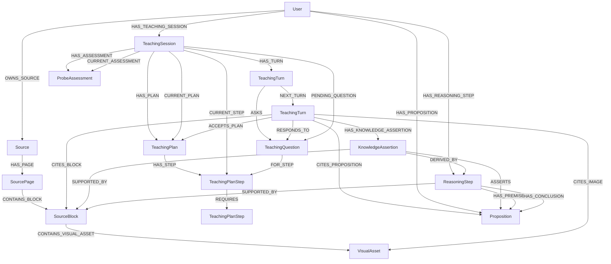

# Teaching sessions and bounded teaching workflows

Status: durable teaching sessions, local-first evidence acquisition, staged
source publication, learner observations, and per-response knowledge admission
are implemented. External research remains disabled by default. Historical
`CITES_EXTERNAL` records require explicit per-user migration and a separate
global finalization operation.

## Problem and decision

Existing `SourceLearningGraph` generates source-scoped cards. Its regeneration
lifecycle clears generated cards and associated review history. A persistent,
possibly cross-source conversation must not inherit that ownership or cleanup.

Introduce a separate `teaching` domain. Start from a goal, persist each completed
interaction, and rebuild bounded execution state from the database. Keep explicit
session state and immutable conversational history; do not introduce a generic
event-sourcing framework, background worker system, or second checkpoint store.

Assume all inputs and inference outputs are valid and perfect. Preconditions
below specify the contract, not requests for downstream checks, output repair,
missing-reference recovery, fallback content, or extra classification gates.
Authorization, atomic persistence, resource release, and concurrent writes remain
real boundary responsibilities.

## Implemented scope

Current behavior includes:

- Typed sessions, learner/teacher turns, questions, assessments, and lesson plans.
- User-scoped lifecycle persistence, optimistic revisions, and atomic writes.
- Provider-neutral DSPy prober, planner, and teacher modules with explicit
  operation-based outputs and runtime demonstrations.
- Instructional responses in probing, planning, or teaching can admit
  propositions and reasoning steps against active inspected evidence; coordination
  responses do not run knowledge extraction.
- A five-node acyclic parent graph invokes a bounded instructional interaction
  graph once. Each evidence action and each research/source-preparation workflow
  runs in its own bounded graph with private state.
- Local source and proposition retrieval precedes any explicit external
  expansion. Discovery remains distinct from inspected evidence.
- Session-workspace positions and receipts; graph UUIDs do not enter model-facing
  context.
- Atomic persistence of the teacher response, session state, citations, learner
  observations, staged sources, proposition assertions, and exact source revisions.

When research is disabled, the teacher can use owned source blocks, images,
statements, procedures, and propositions. When enabled, inspected web pages,
images, and selected PDF pages are processed through the shared source-processing
graph and retained as staged source snapshots in the private session evidence
workspace. They are not publicly owned or searchable until publication.
The successful final teacher-turn transaction saves the workspace and publishes
staged snapshots only when a final block/image citation or admitted knowledge
support uses them. Unused staged snapshots remain private to the session.
No new external-evidence nodes or `CITES_EXTERNAL` relationships are created.

Legacy `CITES_EXTERNAL` citations are migrated per user with
`migrate_research_sources`. Only after every owner has migrated can
`finalize_research_source_migration` remove orphan legacy nodes and drop the old
uniqueness constraint.

## Domain contracts

Persisted vertices extend the existing `Vertex`. Non-vertex requests, snapshots,
and public views use explicit Pydantic contracts with `extra='forbid'`. Use
`StrEnum` for closed sets, backend-assigned UUIDs, and timezone-aware UTC times.
No provider configuration or database imports belong in these models.

| Contract | Responsibility and fields |
|---|---|
| `TeachingSession` | `goal`, `status`, `phase`, `revision`, `created_at`, `updated_at`, `ended_at` in addition to `uuid`. No owner/source/session IDs copied onto related vertices. |
| `TeachingTurn` | One immutable learner or teacher message: `role`, full `content`, `created_at`, and `uuid`. Not a combined request/response pair and not private model thinking. |
| `ProbeAssessment` | Structured diagnostic snapshot: `summary`, typed `strands`, explicitly linked `observation_uuids`, `created_at`, and `uuid`. |
| `ProbeStrand` | Topic, demonstrated starting understanding, observed limit, gaps, and misconceptions. This is diagnostic evidence, not a mastery score. |
| `TeachingPlan` | An immutable plan revision: `summary`, `created_at`, `uuid`, and typed step/dependency collections when loaded. |
| `TeachingPlanStep` | Stable `uuid`, `title`, and `objective`. These are durable lesson objects, not positions in a model request. |
| `TeachingPlanDependency` | Transport description of prerequisite/dependent step UUIDs; persisted as a relationship rather than a duplicate pair of node properties. |
| `TeachingQuestion` | Stable `uuid`, `kind`, prompt, response specification, and creation time. Associated with the teacher turn that first posed it; optionally associated with its plan step. |
| `TeachingSessionSnapshot` | Internal aggregate: session, ordered turns, current assessment, current plan and its acceptance, current step, and pending question. |
| `TeachingTurnCommit` | Complete backend-owned teacher result and intended next session state, including operation-derived heads, learner-observation writes, staged sources, citations, and knowledge admission. This is not a raw DSPy output schema. |
| `TeachingSessionView` | Learner-safe projection of session, conversation, plan, and pending question. It excludes private answer keys and model-internal data. |
| `Proposition` | User-owned self-contained claim with an embedding; equivalent claims can reuse one canonical node. |
| `ReasoningStep` | Joint-premise argument with one conclusion, optional direct source-block support, and a learner-facing explanation. |
| `KnowledgeAssertion` | One teacher turn's admission of a proposition, its direct source-block support, and any reasoning steps. |
| `TeachingEvidenceReference` | A typed `block`, `image`, or `proposition` UUID used for a teacher-turn citation; no external evidence node type. |
| `LearnerObservation` | Append-only, dated interpretation of demonstrated understanding, partial understanding, a gap, or a misconception, linked to its learner-turn evidence and owned by the user. It is not a subject proposition or mutable mastery profile. |

Use `TeachingRole` values `learner` and `teacher`. Future tool records are not
invented learner/teacher turns. The initial goal is session data; starting a
session does not fabricate a conversational message.

`TeachingQuestionKind` distinguishes `probe`, `plan_approval`, `predict`, `check`,
and `clarification`. Its response specification is a discriminated free-response
or multiple-choice contract. Multiple-choice questions carry typed options and a
committed correct option; free-response questions may have a reference answer.
A clarification or goal question legitimately has no correct answer. Public
question views expose the prompt and options, never hidden answer fields.

The question prompt is authoritative for that question and initially matches the
asking turn's visible question. Keeping a structured question is necessary for
answering and later grading; it does not replace the original turn. Do not store
model chain of thought. Structured assessment and lesson decisions are domain
outputs, not private reasoning transcripts.

`None` for a not-yet-created assessment, plan, current step, pending question, or
end time represents a real lifecycle state. It is not missing-output repair.
Commit contracts describe the complete intended state, not a loosely typed patch
whose omitted fields have ambiguous meanings.

Instructional decisions use a discriminated operation union rather than an
independently editable phase plus nullable retain/replace/clear flags. The
operation determines the next phase and complete active heads. The response also
declares whether its content is instruction or coordination, supplies any
learner-observation drafts, and cites only the compact positions of inspected
evidence shown in its final context packet. Backend code resolves all positions
to durable UUIDs before persistence.

Learner observations are produced from learner turns and remain separate from
subject-matter knowledge. An assessment may explicitly reference retrieved
historical observations or observations prepared from the current response.
Question answer keys, embeddings, and model-internal state are not exposed in
the learner-safe views.

## Session state and progression

Keep conversational waiting state separate from instructional phase.

`TeachingStatus`:

- `awaiting_teacher`: a teacher interaction is due, either initially or after a
  learner message. It does not mean a process is currently running.
- `awaiting_learner`: a complete teacher turn has been recorded. There may be one
  pending structured question, or the learner may simply be invited to continue.
- `ended`: terminal for this session. History remains readable.

`TeachingPhase`:

- `probing`: establish the goal, prerequisites, and observed gaps.
- `planning`: propose or revise the lesson route and obtain acceptance.
- `teaching`: work through the accepted plan and respond to learner evidence.

The persisted phase selects its corresponding module at the start of the
interaction and after each evidence action. Tool calls do not persist phase
transitions or create teacher turns. When evidence is needed, the phase first
acquires local source blocks and propositions; external research is a separate
explicit expansion of that local outcome. One final response commits the next
phase and domain heads with the teacher turn. The new phase selects its module
on the next application invocation; no second response is generated implicitly.

Start in `awaiting_teacher` / `probing`. Ending a session does not mark the learner
as having mastered its content. No separate paused/running/failed phase is needed:
not calling the application pauses interaction; an operational failure leaves an
honest durable state from which the caller can explicitly continue.

The main interaction transitions are:

| Operation | Preconditions | Atomic result |
|---|---|---|
| Start | Existing owning user; valid goal. | Create owned session at revision 0, without a required source or fabricated teacher turn. |
| Record teacher turn | `awaiting_teacher`; supplied expected revision. | Append teacher turn, record associated domain objects and head changes, switch to `awaiting_learner`, advance revision. |
| Submit learner response | `awaiting_learner`; supplied expected revision. | Append learner turn, relate it to the pending question if present, switch to `awaiting_teacher`, advance revision. |
| End | Either non-ended status; supplied expected revision. | Set `ended` and end time, remove the active pending-question pointer, advance revision; retain all historical objects. |
| Load/list | User-scoped ownership. | Read only; no inference, phase change, mutation, or regenerated messages. |

A learner response can answer, request a hint, ask a different question, or reject
part of the plan. `RESPONDS_TO` records conversational association, not
correctness. Submission does not itself infer that a question was solved or that
a plan was accepted. While awaiting the teacher, retain the pending question as
context. The next complete teacher result may retain it, replace it, or close it.

There is at most one pending question. A teacher can publish an explanation with
no structured question and still wait for the learner. Do not force a question or
invoke a classifier merely to make the state machine alternate.

During teaching, plan steps are coarse landmarks and may require multiple
reasoning checks. Each new instructional explanation introduces one reasoning
step and poses a structured `CHECK` associated with the current step. The visible
wording asks the same question with the same scope; equivalent phrasing is fine.
A hint or notation clarification retains the exact pending question and current
step. An incorrect or incomplete answer receives a focused repair and a
replacement check at that same step; a changed or resolved gap updates the
existing assessment. A correct answer permits the next reasoning step, and a
dependent plan step begins only after its prerequisites are demonstrated. After
the final successful check, the teacher consolidates, clears the pending
question, retains the final step, and waits for the learner. This cadence is a
teacher policy-and-demonstration contract, not a durable mastery flag, score, or
separate answer-classification stage.

Phase progression is supplied by the relevant workflow, not a separate gate:

- Probing records an assessment and can enter planning when ready.
- Planning proposes or revises the plan; it enters teaching only with acceptance
  of the current plan linked to the learner turn expressing that acceptance.
- Rejecting or revising a plan retains the prior content as history and creates
  a new proposed revision when necessary.
- Teaching can revisit probing or planning when understanding or goals change.
- Replacing the plan requires acceptance of the new revision before teaching
  proceeds on it. Previously posed questions retain their original step links.

Neither visiting a step nor answering a question changes an implicit mastery
flag. The plan is a teaching route, not the canonical argument graph. Its
prerequisite edges do not assert logical entailment between propositions.



The diagram shows relationships, not mandatory edges. `CITES_BLOCK`,
`CITES_IMAGE`, and `CITES_PROPOSITION` link the completed teacher turn to
explicitly cited evidence. A turn's `KnowledgeAssertion` links extracted or
reused propositions to their exact source blocks and reasoning steps. Reasoning
steps connect premise and conclusion propositions and may carry their own direct
block support. Sources own blocks structurally; no source UUID is copied onto
propositions, assertions, or reasoning steps. Question kinds used before a plan
need no `FOR_STEP` edge. Steps and plans belong to one session; cross-session
prerequisites are not part of this contract.
Use session `FIRST_TURN` and `LAST_TURN` pointers plus `NEXT_TURN` for canonical
transcript order, following existing source block/asset ordering patterns. An
empty transcript has neither pointer. Append operations update the tail and
membership atomically. Do not sort solely by timestamps, create all-pairs
context relationships, or persist packet-local positions as transcript metadata.

`HAS_TURN`, `HAS_PLAN`, and `HAS_ASSESSMENT` retain owned history; their current
pointers select the active snapshot without rewriting older content. Plan steps
form a DAG, not a required linear chain. Read it in deterministic dependency order
for presentation; the workflow explicitly selects the current step.

Persist owner, parent, current-object, question/step, response, and acceptance
associations through relationships. UUID references in request/snapshot contracts
are legitimate transport fields; they are not instructions to duplicate
`user_uuid`, `session_uuid`, `source_uuid`, or `plan_uuid` on every graph vertex.

Assessment strands and question response specifications are typed nested values,
not independent graph identities. Serialize them as JSON properties at the
repository boundary because Neo4j properties cannot contain nested maps. Keep
that representation out of model prompts and public contracts. Plans/steps use
vertices because their dependencies and question associations have graph meaning.

Add UUID uniqueness constraints for the new persisted labels through the existing
structural-schema path. Step 1 needs no vector index, GDS projection, embeddings,
or local model startup.

### Teaching invocation and persistence boundaries

One application call runs one parent `TeachingGraph` and commits at most one
teacher turn. The parent is acyclic: retrieve learner history once, invoke the
bounded interaction graph once, prepare learner-observation writes, prepare
knowledge admission when the response is instructional, then persist. The parent
uses a fixed recursion limit. It does not wrap its graph in an outer `while`
loop or restart failed interactions. A later invocation reloads the workspace
saved with the last successful teacher turn.

The interaction graph owns the bounded phase/action loop and a private
`TeachingEvidenceWorkspace`. After an evidence action it returns to the module
selected by the persisted phase; a typed response ends the child graph. Each
evidence action invokes a one-action acquisition graph. External research and
source processing execute inside their own bounded graphs and private states.
The session transaction persists the workspace after a completed turn.

External captures pass through the shared source-processing graph before they
enter the workspace. Their processed blocks and images are readable during the
same interaction, but their source snapshots remain staged and invisible to
normal owner-scoped retrieval. The final transaction publishes staged snapshots
only when cited or used as knowledge support; unused snapshots remain private
in the saved workspace. A failed or stale commit publishes neither the turn nor
source ownership and retains the preceding workspace. Content-addressed files
from the failed invocation may remain unreferenced. The system does not save the
conversation as a synthetic source or automatically run
source-pedagogical/source-semantic stages on research captures.

Knowledge extraction occurs once after the final response is selected, not on
each probe/action and not as a separate teaching phase. Any response marked
`instruction` may admit propositions and reasoning against its final active
inspected source/image/proposition packet, regardless of the persisted
probing/planning/teaching phase. `coordination` skips knowledge admission.
The extraction and identity graphs prepare writes without persistence; the
repository writes them in the same transaction as the teacher turn, source
publication, citations, and session heads.

Learner observations describe what the learner demonstrated, including
misconceptions or gaps; they are not subject propositions. Each observation is
prepared from one response and links to the learner-turn evidence selected by
that response. An assessment can reference retrieved historical observations or
these newly prepared observations. The observation, its evidence edges, the new
assessment's `BASED_ON` edges, and the teacher turn commit atomically.

## Service and repository boundary

`TeachingService(repository: TeachingRepository)` owns lifecycle transitions,
UUID/time assignment, preparation of domain records, and learner-safe views.
Composition supplies the repository; the service does not construct clients.

`TeachingRepository(session_factory)` owns user-scoped reads and atomic writes.
Queries always start from the owning user and reach the session through
`HAS_TEACHING_SESSION`; do not load by bare session UUID and authorize afterward.
Referenced plans, steps, questions, and turns must belong to that session.

Proposed repository operations:

- `create_session(user_uuid, session)`.
- `list_sessions(user_uuid)` in stable recent-update order, UUID as tie-break.
- `load_session(user_uuid, session_uuid)` returning the internal snapshot.
- `append_response(user_uuid, session_uuid, expected_revision, turn)`.
- `record_turn(user_uuid, session_uuid, expected_revision, commit)`.
- `end_session(user_uuid, session_uuid, expected_revision, ended_at)`.

Each state-changing operation writes its history and current state in one
transaction and returns the resulting snapshot. `record_turn` writes the teacher
message, operation-derived phase and session heads, new assessment/plan/steps,
question and acceptance relationships, evidence citations, learner observations
and their learner-turn provenance, assessment links, staged-source publication,
optional knowledge assertions, status, and revision together. Existing immutable
object content is never overwritten merely because it is referenced again.

Require exactly one user-scoped result for single-session reads/writes, following
the repository's existing `single(strict=True)` convention. A list may be empty.
Do not return empty/fallback sessions or swallow missing ownership matches.

### Concurrent writes

`revision` is a persisted concurrency token, not an ordinal or mastery score.
Writes compare the caller's expected revision under a session write lock before
committing the next revision. A check performed before acquiring the lock is not
sufficient. A stale/no-match write must roll back the whole transaction, including
any lock-acquisition mutation; consume the strict result inside that transaction.
Do not use an autocommit mutation that survives discovering a stale revision.

This prevents two submissions or completions from overwriting one another and
prevents a late completion from reopening an ended session. Different sessions
remain independent. It does not promise that duplicate concurrent inference
requests execute only once; dispatch coordination belongs to the later inference
workflow. Do not add leases, background queues, automatic replay, or silent
conflict retries to step 1.

## Application API and resource lifetime

User-scoped operations use `Settings` and `user_uuid`; the global finalizer is
the exception.

| Public operation | Remaining arguments | Return / effect |
|---|---|---|
| `start_teaching_session` | `goal` | Create and return `TeachingSessionView`; no model call. |
| `list_teaching_sessions` | None | Return the user's sessions without loading every transcript. |
| `load_teaching_session` | `session_uuid` | Return `TeachingSessionView`; resume display. |
| `submit_teaching_response` | `session_uuid`, `content`, keyword-only `expected_revision` | Persist the learner response. |
| `run_teaching_turn` | `session_uuid`, keyword-only `expected_revision`, optional `source_uuids` allowlist | Run one bounded parent/interaction workflow; atomically persist the response, citations, observations, staged sources, and any instruction knowledge admission. |
| `end_teaching_session` | `session_uuid`, keyword-only `expected_revision` | End the session without deleting history. |
| `search_sources` / `read_source_passages` / `read_source_images` | Query or block/image UUIDs | Search or read owned source evidence. |
| `search_source_statements` / `read_source_statements` | Query or statement UUIDs | Search or read reconstructed statements with member blocks. |
| `search_source_procedures` / `read_source_procedures` | Query or procedure UUIDs | Search or read reconstructed procedures with member blocks. |
| `search_propositions` / `read_propositions` | Query or proposition UUIDs | Search user-owned claims or read bounded per-turn provenance. |
| `read_reasoning_steps` | Reasoning-step UUIDs | Read one-hop premises, conclusion, explanation, and direct support blocks. |
| `search_learner_observations` / `read_learner_observations` | Query or observation UUIDs | Search owner-scoped learner evidence or read safe observation records with provenance. |
| `read_teaching_citations` / `read_teaching_citation_media` | `session_uuid` and typed references or image UUID | Read cited block/image/proposition views or authorized image bytes. |
| `migrate_research_sources` | None | Convert this user's legacy external citations into ordinary owned sources. |
| `finalize_research_source_migration` | None | Database-only global cleanup; refuses while any legacy citations remain. |

`run_teaching_turn` first loads the user-owned snapshot and checks its
`awaiting_teacher` status and expected revision. It releases that database scope
before authentication preflight and inference resources. Knowledge extraction
preflight is unconditional because any phase may emit an instructional response.
When research is enabled, the application opens invocation-scoped Tavily/media
resources; otherwise it opens none.

The parent teaching graph has a fixed, acyclic history → interaction →
observation preparation → knowledge preparation → persistence sequence. Its
bounded interaction child repeats phase prediction and tool execution until one
response is selected. Each tool action invokes its own one-action evidence graph;
external research has an independent cap. A later learner interaction starts a
new parent invocation from persisted state and restores the session workspace.

The service's internal `record_teaching_turn` operation accepts a
`TeachingTurnCommit` and expected revision. It is used by orchestration and
database verification, not exposed as a UI action letting a learner impersonate
the teacher. Backend code assigns record UUIDs and timestamps; model outputs do
not choose database identities for new objects.

Use `_database_resources` for database-only operations and
`_application_resources` for one teacher invocation. Composition reuses the
configured predictor factory, embedding/reranking clients, tokenizers, and
source evidence services. No transaction remains open during inference or tool
calls.

### Optional external research

`research.enabled` defaults to `false`. Enabling it requires
`research.tavily.api_key` (`KMS2_RESEARCH__TAVILY__API_KEY`). An explicit
external expansion is available only after a phase has created a local outcome
from owned-source and proposition search. It carries the same question, context,
and URLs to the researcher; local findings are supplied as inspected content or
bounded discovery previews, not as external citations. Empty local results do
not force web use.

The teaching interaction graph keeps its phase module active while tool actions
run. Each research invocation has its own `research.max_tool_calls` cap, and
source admission runs the shared `SourceProcessingGraph` with database
persistence disabled. `SourceAdmissionGraph` returns either an unchanged owned
snapshot or a finalized staged snapshot. Staged blocks/images can be read and
cited inside the session workspace but do not appear in ordinary owner-scoped
search until publication.
Reasoning references discovered by a proposition or reasoning read reflect
that read only. Their registry positions remain stable for the interaction, so a
later read can rediscover an earlier reference without carrying every prior
discovery into the next prediction.

The final turn transaction saves the session workspace, publishes cited or
knowledge-supporting staged snapshots, and writes the teacher response,
citations, learner observations, and instruction-derived knowledge together.
Unused staged snapshots remain in the private workspace, not as owned sources;
acquired owned sources still receive revision checks. The transaction locks the
relevant source set, reloads staged winners, checks processed identity and source
revisions, and rechecks session and knowledge revisions. A conflict rolls back
all graph writes. Original image bytes remain in content-addressed files and are
rehydrated when the workspace is restored. A failed turn retains the previously
committed workspace rather than saving partially completed actions. Research
captures are not automatically run through Source Pedagogical or Source Semantic
and are not combined into a synthetic teaching-session source.

PDF retrieval reads native text for discovery and renders/OCRs only selected
pages. Web snapshots preserve retrieved Markdown and inspected downloaded
images. Finalized block/image UUIDs are content-derived before those records can
be read or used as support. Snapshot identity uses captured URLs and content,
not the page title, so a title change alone does not create another source.
Download size, redirects, image pixels, concurrency, inference tokens, and tool
calls have configured limits. Public media requests do not use ambient proxy
credentials and reject non-public addresses.

Historical `CITES_EXTERNAL` citations are a separate explicit cutover. Call
`migrate_research_sources(settings, user_uuid)` for each owner; it preserves
retained text/media without re-fetching or inventing descriptions, rewrites
citations to ordinary source blocks/images, and keeps shared legacy records
until no user references them. Image-only legacy records stay readable/citable
but are not text-searchable unless a retained description exists. Once every
owner is migrated, `finalize_research_source_migration(settings)` checks for
global legacy citations, deletes only orphan legacy records, and drops the old
uniqueness constraint. Its global guard is safe to rerun after completion.

Evidence registry positions persist within the session workspace; visible
citation-candidate positions are rebuilt for each prediction. The persistence
node maps explicitly cited positions to backend UUIDs and stores typed citation
edges. Inspected context may separately support knowledge assertions or
reasoning without becoming a visible turn citation. Both citations and knowledge
support are authorized and persisted in the same source/session-revision-locked
transaction as the teacher turn. Image inspection is associated with the exact
source revision.
Citation views and media reads authorize through an owned session and its
citation edges; they do not expose storage paths. They are database/file reads
and do not start retrieval or inference resources.


The file store and Neo4j do not share a transaction. A failed or stale graph
commit can leave a content-addressed media blob that no citation references;
session-authorized reads cannot reach it.

Every operation closes resources before returning. Pending questions are durable
objects, not live futures. A model or tool failure propagates without persisting
a partial teacher response; committed learner input remains in
`awaiting_teacher`. A stale final write rolls back all teacher-side changes.
There is no automatic replay, fallback response, or transport idempotency layer.

If persistence succeeds but delivery to the caller fails, load the session to
observe its committed state. The workflow does not promise exactly-once network
request replay.

## Current file ownership

The feature follows the existing model/service/repository/application layers:

```text
src/kms2/
  config/research.py
  core/model/
    knowledge/                 # Proposition, reasoning, admission, retrieval contracts
    source_processing/         # Typed inputs reused for source and research admission
    teaching/                  # Session, inference, citation, and turn contracts
  module/
    knowledge/                 # Proposition extraction and equivalence examples
    teaching/                  # Prober, planner, and teacher modules/examples
  langgraph/
    evidence_acquisition/    # One evidence action per bounded invocation
    knowledge/               # Instruction-response knowledge preparation
    research/                # Invocation-only external discovery
    source_admission/        # Shared processing and staged snapshot finalization
    teaching/                # Acyclic parent turn and bounded interaction loop
  node/
    evidence_acquisition/    # Local reads, explicit external expansion, staging
    knowledge/identity.py    # Owned proposition candidates and draft reconciliation
    teaching/                # Context, operations, observations, admission, persistence
  service/
    knowledge.py             # Proposition/reasoning admission
    knowledge_search.py      # User-scoped proposition/reasoning retrieval
    learner_observations.py  # Append-only learner evidence and safe views
    research_evidence.py     # Invocation evidence and source capture preparation
    research_source_migration.py # Explicit legacy citation migration
    source_admission.py      # Capture, process, and finalize unpublished snapshots
    source_evidence.py       # Owned source block/image/statement/procedure reads
    teaching.py              # Session transitions and atomic turn orchestration
  database/
    knowledge/               # Owned proposition/reasoning reads and admission writes
    source/                  # Source snapshots, migration, blocks, and source records
    teaching/                # Session state, turns, observations, citations, atomic commits
  composition/               # Dependency construction for the above services/graphs
  application.py             # Public operations and resource lifetimes
```

`SourceAdmissionGraph` invokes the established `SourceProcessingGraph` with
Neo4j persistence disabled and returns a finalized staged snapshot. The
`TeachingPersistenceNode` supplies the workspace, used staged sources, inspected
citations, prepared observations, and optional knowledge admission to one
`TeachingRepository.record_turn` transaction. Source ownership, teacher turn,
workspace, learner evidence, citations, assessment links, knowledge assertions,
and session heads either commit together or roll back together.
Source admission gives this nested one-shot graph its own recursion budget,
independent of the smaller evidence-action budget.

Knowledge preparation is not tied to the teaching phase. A response marked as
instruction can admit supported propositions and reasoning from any phase; a
coordination response does not invoke extraction. Learner misconceptions remain
append-only learner observations and do not become canonical subject claims.
Source entities remain source-owned and source-scoped; they are not canonical
proposition identities.

## Verification boundaries

- Exercise public application operations and repository transactions against a
  disposable Neo4j database, never the user's configured database.
- Verify user-scoped retrieval, inspected-only citations, source/knowledge
  revision checks, mutation locks, and all-or-nothing teacher-turn persistence.
- Verify source admission uses the shared processing graph and preserves text,
  page/block ordering, image bytes, and ownership across reload.
- Verify proposition identity reuse without merging distinct claims; verify
  premise/conclusion links and turn-specific direct source support.
- Verify legacy external citations migrate per user and global finalization
  refuses while any citation remains, then removes only unreferenced legacy data.
- Run configured formatting, lint, and deterministic KMS2 tests. These prove
  software behavior, not hosted model quality or instructional effectiveness.

A deterministic disposable-Neo4j smoke now exercises the end-to-end boundary:
local-first knowledge search before explicit web expansion, staged passage and
image inspection while the source remains unpublished, successful atomic
publication with the teacher turn, learner observation, and prepared knowledge,
history retrieval with the original learner evidence and question, plan proposal
and acceptance followed by a separate teaching turn, source-owned citation and
two-premise reasoning, and rollback of a stale commit containing a second staged
source and draft records. This verifies graph and persistence behavior with
injected predictors, not hosted-provider quality.

## Existing conventions informing this design

- [Vertex and strict model fields](../src/kms2/core/model/base.py).
- [Learning service ownership](../src/kms2/service/learning.py).
- [Repository single-row contracts](../src/kms2/database/learning/repository.py).
- [Database-only composition](../src/kms2/composition/services.py).
- [Application resource lifetimes](../src/kms2/application.py).
- [Structural schema](../src/kms2/database/schema.py).
- [Canonical source ordering](../src/kms2/database/source/queries/source_graph.py).
- [Python style](STYLE.md).
