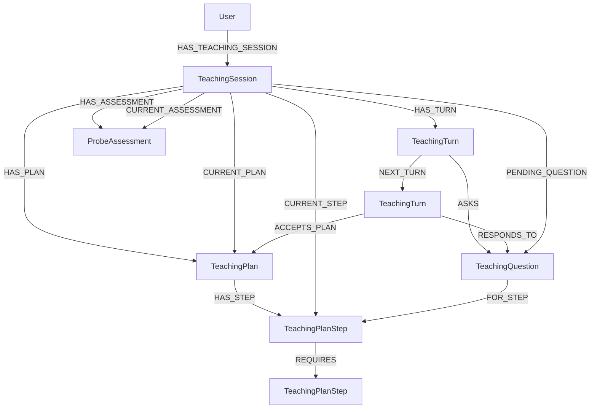

# Teaching session foundation

Status: step 1 persistence foundation implemented. This step builds persistent
interaction state, not a teacher, retriever, proposition extractor, or practice
engine. Later workflow sections remain design contracts.

## Problem and decision

Existing `SourceLearningGraph` generates source-scoped cards. Its regeneration
lifecycle clears generated cards and associated review history. A persistent,
possibly cross-source conversation must not inherit that ownership or cleanup.

Introduce a separate `teaching` domain. Start from a goal, persist each completed
interaction, and rebuild bounded execution state from the database. Keep explicit
session state and immutable conversational history; do not introduce a generic
event-sourcing framework, background worker system, or second checkpoint store.

Assume all inputs and inference outputs are valid and perfect. Preconditions
below specify the contract, not requests for downstream checks, output repair,
missing-reference recovery, fallback content, or extra classification gates.
Authorization, atomic persistence, resource release, and concurrent writes remain
real boundary responsibilities.

## Scope

Step 1 includes:

- Typed sessions, learner/teacher turns, questions, assessments, and lesson plans.
- User-scoped persistence and atomic lifecycle transitions.
- Database-only application operations to start, list, load, respond, and end.
- An internal operation to record a complete teacher turn and its state changes.
- Deterministic behavior coverage and a disposable-database application smoke.

Step 1 does not include model prompts, tool execution, source search, external
search, citation storage, proposition admission, practice, FSRS changes, or a new
interactive UI. These are separately ordered roadmap items. A supplied complete
teacher result can exercise persistence during verification; it is not a fake
teacher implementation or evidence that live teaching works.

## Domain contracts

Persisted vertices extend the existing `Vertex`. Non-vertex requests, snapshots,
and public views use explicit Pydantic contracts with `extra='forbid'`. Use
`StrEnum` for closed sets, backend-assigned UUIDs, and timezone-aware UTC times.
No provider configuration or database imports belong in these models.

| Contract | Responsibility and fields |
|---|---|
| `TeachingSession` | `goal`, `status`, `phase`, `revision`, `created_at`, `updated_at`, `ended_at` in addition to `uuid`. No owner/source/session IDs copied onto related vertices. |
| `TeachingTurn` | One immutable learner or teacher message: `role`, full `content`, `created_at`, and `uuid`. Not a combined request/response pair and not private model thinking. |
| `ProbeAssessment` | Structured diagnostic snapshot: `summary`, typed `strands`, `created_at`, and `uuid`. |
| `ProbeStrand` | Topic, demonstrated starting understanding, observed limit, gaps, and misconceptions. This is diagnostic evidence, not a mastery score. |
| `TeachingPlan` | An immutable plan revision: `summary`, `created_at`, `uuid`, and typed step/dependency collections when loaded. |
| `TeachingPlanStep` | Stable `uuid`, `title`, and `objective`. These are durable lesson objects, not positions in a model request. |
| `TeachingPlanDependency` | Transport description of prerequisite/dependent step UUIDs; persisted as a relationship rather than a duplicate pair of node properties. |
| `TeachingQuestion` | Stable `uuid`, `kind`, prompt, response specification, and creation time. Associated with the teacher turn that first posed it; optionally associated with its plan step. |
| `TeachingSessionSnapshot` | Internal aggregate: session, ordered turns, current assessment, current plan and its acceptance, current step, and pending question. |
| `TeachingTurnCommit` | Complete backend-owned teacher result and intended next session state, including retained or new assessment/plan/question references. This is not a raw DSPy output schema. |
| `TeachingSessionView` | Learner-safe projection of session, conversation, plan, and pending question. It excludes private answer keys and model-internal data. |

Use `TeachingRole` values `learner` and `teacher`. Future tool records are not
invented learner/teacher turns. The initial goal is session data; starting a
session does not fabricate a conversational message.

`TeachingQuestionKind` distinguishes `probe`, `plan_approval`, `predict`, `check`,
and `clarification`. Its response specification is a discriminated free-response
or multiple-choice contract. Multiple-choice questions carry typed options and a
committed correct option; free-response questions may have a reference answer.
A clarification or goal question legitimately has no correct answer. Public
question views expose the prompt and options, never hidden answer fields.

The question prompt is authoritative for that question and initially matches the
asking turn's visible question. Keeping a structured question is necessary for
answering and later grading; it does not replace the original turn. Do not store
model chain of thought. Structured assessment and lesson decisions are domain
outputs, not private reasoning transcripts.

`None` for a not-yet-created assessment, plan, current step, pending question, or
end time represents a real lifecycle state. It is not missing-output repair.
Commit contracts describe the complete intended state, not a loosely typed patch
whose omitted fields have ambiguous meanings.

## Session state and progression

Keep conversational waiting state separate from instructional phase.

`TeachingStatus`:

- `awaiting_teacher`: a teacher interaction is due, either initially or after a
  learner message. It does not mean a process is currently running.
- `awaiting_learner`: a complete teacher turn has been recorded. There may be one
  pending structured question, or the learner may simply be invited to continue.
- `ended`: terminal for this session. History remains readable.

`TeachingPhase`:

- `probing`: establish the goal, prerequisites, and observed gaps.
- `planning`: propose or revise the lesson route and obtain acceptance.
- `teaching`: work through the accepted plan and respond to learner evidence.

Start in `awaiting_teacher` / `probing`. Ending a session does not mark the learner
as having mastered its content. No separate paused/running/failed phase is needed:
not calling the application pauses interaction; an operational failure leaves an
honest durable state from which the caller can explicitly continue.

The main interaction transitions are:

| Operation | Preconditions | Atomic result |
|---|---|---|
| Start | Existing owning user; valid goal. | Create owned session at revision 0, without a required source or fabricated teacher turn. |
| Record teacher turn | `awaiting_teacher`; supplied expected revision. | Append teacher turn, record associated domain objects and head changes, switch to `awaiting_learner`, advance revision. |
| Submit learner response | `awaiting_learner`; supplied expected revision. | Append learner turn, relate it to the pending question if present, switch to `awaiting_teacher`, advance revision. |
| End | Either non-ended status; supplied expected revision. | Set `ended` and end time, remove the active pending-question pointer, advance revision; retain all historical objects. |
| Load/list | User-scoped ownership. | Read only; no inference, phase change, mutation, or regenerated messages. |

A learner response can answer, request a hint, ask a different question, or reject
part of the plan. `RESPONDS_TO` records conversational association, not
correctness. Submission does not itself infer that a question was solved or that
a plan was accepted. While awaiting the teacher, retain the pending question as
context. The next complete teacher result may retain it, replace it, or close it.

There is at most one pending question. A teacher can publish an explanation with
no structured question and still wait for the learner. Do not force a question or
invoke a classifier merely to make the state machine alternate.

Phase progression is supplied by the relevant workflow, not a separate gate:

- Probing may produce an assessment and a proposed plan, entering planning.
- Planning enters teaching only with acceptance of the current plan linked to
  the learner turn expressing that acceptance.
- Rejecting or revising a plan retains the prior content as history and creates
  a new proposed revision when necessary.
- Teaching can revisit probing or planning when understanding or goals change.
- Replacing the plan requires acceptance of the new revision before teaching
  proceeds on it. Previously posed questions retain their original step links.

Neither visiting a step nor answering a question changes an implicit mastery
flag. The plan is a teaching route, not the canonical argument graph. Its
prerequisite edges do not assert logical entailment between propositions.

## Neo4j topology and ordering



The diagram shows relationship types, not mandatory edges. A new session has
only its ownership edge. The example `ASKS` originates from a teacher turn and
`RESPONDS_TO`/`ACCEPTS_PLAN` from a learner turn. Question kinds used before a plan
need no `FOR_STEP` edge. Steps and plans belong to one session; cross-session
prerequisites are not part of this contract.

Use session `FIRST_TURN` and `LAST_TURN` pointers plus `NEXT_TURN` for canonical
transcript order, following existing source block/asset ordering patterns. An
empty transcript has neither pointer. Append operations update the tail and
membership atomically. Do not sort solely by timestamps, create all-pairs
context relationships, or persist packet-local positions as transcript metadata.

`HAS_TURN`, `HAS_PLAN`, and `HAS_ASSESSMENT` retain owned history; their current
pointers select the active snapshot without rewriting older content. Plan steps
form a DAG, not a required linear chain. Read it in deterministic dependency order
for presentation; the workflow explicitly selects the current step.

Persist owner, parent, current-object, question/step, response, and acceptance
associations through relationships. UUID references in request/snapshot contracts
are legitimate transport fields; they are not instructions to duplicate
`user_uuid`, `session_uuid`, `source_uuid`, or `plan_uuid` on every graph vertex.

Assessment strands and question response specifications are typed nested values,
not independent graph identities. Serialize them as JSON properties at the
repository boundary because Neo4j properties cannot contain nested maps. Keep
that representation out of model prompts and public contracts. Plans/steps use
vertices because their dependencies and question associations have graph meaning.

Add UUID uniqueness constraints for the new persisted labels through the existing
structural-schema path. Step 1 needs no vector index, GDS projection, embeddings,
or local model startup.

## Service and repository boundary

`TeachingService(repository: TeachingRepository)` owns lifecycle transitions,
UUID/time assignment, preparation of domain records, and learner-safe views.
Composition supplies the repository; the service does not construct clients.

`TeachingRepository(session_factory)` owns user-scoped reads and atomic writes.
Queries always start from the owning user and reach the session through
`HAS_TEACHING_SESSION`; do not load by bare session UUID and authorize afterward.
Referenced plans, steps, questions, and turns must belong to that session.

Proposed repository operations:

- `create_session(user_uuid, session)`.
- `list_sessions(user_uuid)` in stable recent-update order, UUID as tie-break.
- `load_session(user_uuid, session_uuid)` returning the internal snapshot.
- `append_response(user_uuid, session_uuid, expected_revision, turn)`.
- `record_turn(user_uuid, session_uuid, expected_revision, commit)`.
- `end_session(user_uuid, session_uuid, expected_revision, ended_at)`.

Each state-changing operation writes its history and current state in one
transaction and returns the resulting snapshot. `record_turn` writes the visible
teacher message, new assessment/plan/steps, question, acceptance relationships,
current pointers, status, and revision together. Existing immutable object content
is never overwritten merely because it is referenced again.

Require exactly one user-scoped result for single-session reads/writes, following
the repository's existing `single(strict=True)` convention. A list may be empty.
Do not return empty/fallback sessions or swallow missing ownership matches.

### Concurrent writes

`revision` is a persisted concurrency token, not an ordinal or mastery score.
Writes compare the caller's expected revision under a session write lock before
committing the next revision. A check performed before acquiring the lock is not
sufficient. A stale/no-match write must roll back the whole transaction, including
any lock-acquisition mutation; consume the strict result inside that transaction.
Do not use an autocommit mutation that survives discovering a stale revision.

This prevents two submissions or completions from overwriting one another and
prevents a late completion from reopening an ended session. Different sessions
remain independent. It does not promise that duplicate concurrent inference
requests execute only once; dispatch coordination belongs to the later inference
workflow. Do not add leases, background queues, automatic replay, or silent
conflict retries to step 1.

## Application API and resource lifetime

All functions below are proposed async operations in `application.py`. Their
first argument is the existing `Settings`; they also require `user_uuid`.

| Public operation | Remaining arguments | Return / effect |
|---|---|---|
| `start_teaching_session` | `goal` | Create and return `TeachingSessionView`; no model call. |
| `list_teaching_sessions` | None | Return the user's `list[TeachingSession]`, without loading every transcript. |
| `load_teaching_session` | `session_uuid` | Return `TeachingSessionView`; this is how a UI resumes display. |
| `submit_teaching_response` | `session_uuid`, `content`, keyword-only `expected_revision` | Persist the response and return the updated view, ready for a teacher interaction. |
| `end_teaching_session` | `session_uuid`, keyword-only `expected_revision` | Return the ended view; history is not deleted. |

Do not add a `resume_teaching_session` alias that merely duplicates load. Reading
and continuing are distinct operations. When inference is introduced, an explicit
`run_teaching_turn` operation loads an awaiting-teacher snapshot, releases the
read transaction, executes the bounded graph, and records its complete result.
That inference operation is not a nonfunctional placeholder in step 1.

The service's internal `record_teaching_turn` operation accepts a
`TeachingTurnCommit` and expected revision. It is used by the future orchestration
and directly by deterministic/database verification, not exposed as a UI action
letting a learner impersonate the teacher. Backend code assigns record UUIDs and
timestamps; raw model outputs never choose database identities for new objects.

Use `_database_resources` for the public step-1 operations. Add
`build_teaching_service(database)` beside the current builders in
`composition/services.py`. No teaching inference config is needed until there is
inference to configure; do not create empty module/node/graph/config packages.

Every operation closes resources before returning. Pending questions are durable
objects, not live futures. A later model/tool failure propagates while leaving
already committed learner input in `awaiting_teacher`. Explicitly continuing
operates on that pending input without appending it again. A failure during the
final write rolls back all teacher-side changes. No partial teacher message,
placeholder answer, repaired output, or synthetic success is persisted.

If persistence succeeds but delivery to the caller fails, load the session to
observe its committed state. Step 1 does not promise exactly-once network request
replay or add a transport idempotency framework.

## Planned file ownership

Create only the files needed for the complete step-1 behavior:

```text
src/kms2/
  core/model/teaching/
    session.py       # Session, lifecycle, snapshot/view, complete commit contract
    turn.py          # Turn role and immutable message vertex
    probe.py         # Assessment and strand contracts
    plan.py          # Plan/step/dependency/acceptance contracts
    question.py      # Question kinds, response specifications, safe question view
  service/teaching.py
  database/teaching/
    repository.py
    queries/
      session.py     # Create/list/load/end
      turn.py        # Atomic learner and teacher transitions
  composition/services.py  # Add the database-only service builder
  database/schema.py       # Add structural uniqueness constraints
  application.py           # Add the five public operations
```

Keep aggregate snapshot/commit contracts in `session.py`, importing the primitive
plan/probe/question/turn records. Those records do not import the aggregates.
This keeps the dependency direction explicit without circular imports,
forward-import workarounds, or a generic contracts framework.

This is additive. Do not modify source processing, source pedagogical, source
semantic, source card generation, or FSRS behavior to implement the foundation.
Do not add a hidden call from ingestion into session creation.

## Implementation and acceptance checks

1. Define the concrete contracts and learner-safe projections. Test meaningful
   serialization boundaries, especially that internal answer keys never appear
   in nested public views. Do not write prompt-text or constructor-default tests.
2. Implement user-scoped repository queries, structural constraints, service
   transitions, and application operations. Service tests cover valid lifecycle
   transitions, question association versus correctness, plan revisions and
   acceptance, and current-state/history separation.
3. Use a disposable authenticated Neo4j instance, never reset or repurpose the
   user's configured database. Exercise the actual repository and application:
   - Start from a goal with no source or transcript; reload it unchanged through
     a fresh application invocation.
   - Record a concrete probe question, reload its public view, submit a learner
     response, and observe the ordered transcript and response association.
   - Record an assessment and proposed plan, accept it through a learner turn,
     advance to teaching, then revise the plan without altering the old revision
     or its questions.
   - Demonstrate both retained questions after clarification and replacement
     questions after a completed teaching interaction.
   - End while awaiting either side; retain history, close the active question,
     and prove a stale completion cannot publish afterward.
   - Interleave two writes using the same expected revision. Exactly one commits;
     the other leaves no extra turn, pointer, or revision mutation. Coordinate
     with events/barriers, not sleeps.
   - Demonstrate foreign-user reads/writes cannot reach a session and public
     views never disclose answer keys.
   - Exercise a real transactional failure and observe no partial teacher-side
     state. Confirm that unrelated sessions, sources, cards, and review history
     remain unchanged.
4. Verify the database-only application operations do not start LLM, embedding,
   reranking, or GPU resources. Run the configured formatter/linter and relevant
   existing tests; keep concurrency and persistence tests consumer-visible, not
   mock echoes of parameters or source-text assertions.

The smoke uses supplied, complete domain results for the internal recording
operation and must be reported as persistence/application proof, not live model
proof. Live teaching quality, retrieval, and UI verification are acceptance work
for later roadmap steps.

## Existing conventions informing this design

- [Vertex and strict model fields](../src/kms2/core/model/base.py).
- [Learning service ownership](../src/kms2/service/learning.py).
- [Repository single-row contracts](../src/kms2/database/learning/repository.py).
- [Database-only composition](../src/kms2/composition/services.py).
- [Application resource lifetimes](../src/kms2/application.py).
- [Structural schema](../src/kms2/database/schema.py).
- [Canonical source ordering](../src/kms2/database/source/queries/source_graph.py).
- [Python style](STYLE.md).
