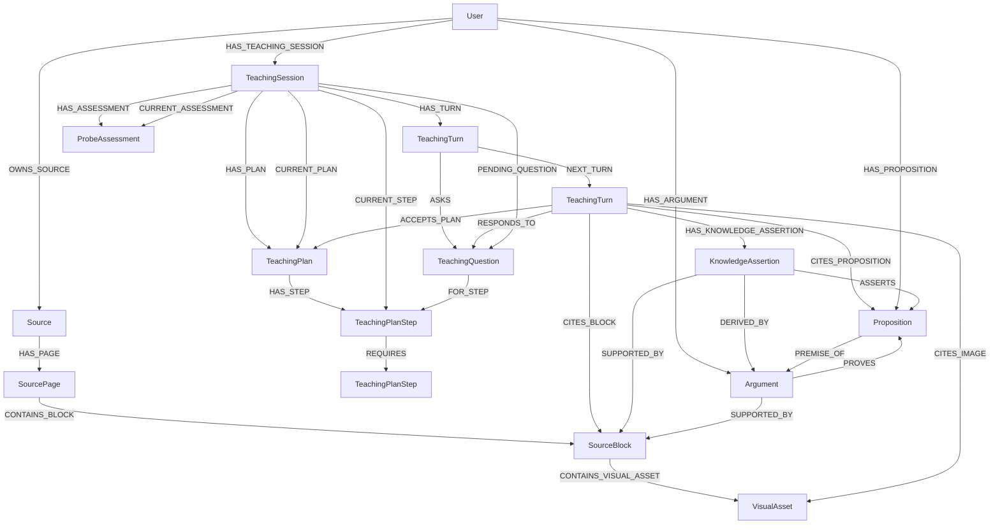

# Teaching sessions and bounded teaching workflows

Status: durable teaching sessions, local-first evidence acquisition, immediate
owned-source admission, reference-only workspaces, learner observations, and
per-response knowledge admission are implemented. External research remains
disabled by default.

## Problem and decision

Existing `SourceLearningGraph` generates source-scoped cards. Its regeneration
lifecycle clears generated cards and associated review history. A persistent,
possibly cross-source conversation must not inherit that ownership or cleanup.

Introduce a separate `teaching` domain. Start from a goal, persist each completed
interaction, and rebuild bounded execution state from the database. Keep explicit
session state and immutable conversational history; do not introduce a generic
event-sourcing framework, background worker system, or second checkpoint store.

Assume all inputs and inference outputs are valid and perfect. Preconditions
below specify the contract, not requests for downstream checks, output repair,
missing-reference recovery, fallback content, or extra classification gates.
Authorization, atomic persistence, resource release, and concurrent writes remain
real boundary responsibilities.

## Implemented scope

Current behavior includes:

- Typed sessions, learner/teacher turns, questions, assessments, and lesson plans.
- User-scoped lifecycle persistence, optimistic revisions, and atomic writes.
- Provider-neutral DSPy prober, planner, and teacher modules with explicit
  operation-based outputs and runtime demonstrations.
- Instructional responses in probing, planning, or teaching can admit
  propositions and arguments against active inspected evidence; coordination
  responses do not run knowledge extraction.
- One teaching graph contains the bounded instructional and research decision
  phases. Evidence actions dispatch directly; source admission uses a service
  and the reusable source-processing graph.
- `AcquireEvidenceAction` searches owned source blocks and canonical propositions
  before optional external research. Research exposes ordered Tavily
  title/URL/snippet results for explicit selection; only selected URLs are
  captured and sent through normal source admission, which owns OCR and
  persistence.
- Independent local searches cover source blocks, source statements/exercises,
  source procedures, canonical propositions, arguments, and learner
  observations. They are invoked when useful, not all run automatically.
  Searches are discovery; read selected records before relying on them. An
  empty final selector result means no relevant hit, not a provider failure or
  an automatic request to research. `source_uuids` constrains source-backed
  searches and research, not canonical knowledge or learner-observation search.
- Session-workspace positions and receipts; graph UUIDs do not enter model-facing
  context.
- Atomic persistence of the teacher response, session state, workspace
  references, citations, learner observations, proposition assertions, and exact
  source revisions.

When research is enabled, the researcher sees Tavily result titles, URLs, and
snippets with stable positions. It explicitly submits selected positions; only
those URLs are captured and passed to the normal source-admission pipeline.
That pipeline performs source processing, including OCR, and persists sources
before returning their UUIDs and revisions. Unselected results are never
captured or processed. External research is unavailable when an explicit source
allowlist is active; it is never silently widened. The teaching workflow then
searches newly admitted source UUIDs through ordinary owned-source retrieval.
The researcher does not read or inspect captured content; the teacher reads
source blocks and uses its normal image-reading and inspection actions.

The saved teaching workspace is typed. Source block, image, group, and citation
records retain graph references and exact source revisions; other catalogs keep
their domain-specific saved values. Learner-observation slots persist only the
observation UUID and `was_read` state. Reload batch-reads observations through
the owning user's graph, preserves registry order and active/discovered
positions, and restores full records only for previously read slots. Source
revision changes prune stale source evidence without disturbing learner
observations. Source text and image bytes are not copied into the session;
original media remains in the content-addressed file store.

## Domain contracts

Persisted vertices extend the existing `Vertex`. Non-vertex requests, snapshots,
and public views use explicit Pydantic contracts with `extra='forbid'`. Use
`StrEnum` for closed sets, backend-assigned UUIDs, and timezone-aware UTC times.
No provider configuration or database imports belong in these models.

| Contract | Responsibility and fields |
|---|---|
| `TeachingSession` | `goal`, `status`, `phase`, `revision`, `created_at`, `updated_at`, `ended_at` in addition to `uuid`. No owner/source/session IDs copied onto related vertices. |
| `TeachingTurn` | One immutable learner or teacher message: `role`, full `content`, `created_at`, and `uuid`. Not a combined request/response pair and not private model thinking. |
| `ProbeAssessment` | Structured diagnostic snapshot: `summary`, typed `strands`, explicitly linked `observation_uuids`, `created_at`, and `uuid`. |
| `ProbeStrand` | Topic, demonstrated starting understanding, observed limit, gaps, and misconceptions. This is diagnostic evidence, not a mastery score. |
| `TeachingPlan` | An immutable plan revision: `summary`, `created_at`, `uuid`, and typed step/dependency collections when loaded. |
| `TeachingPlanStep` | Stable `uuid`, `title`, and `objective`. These are durable lesson objects, not positions in a model request. |
| `TeachingPlanDependency` | Transport description of prerequisite/dependent step UUIDs; persisted as a relationship rather than a duplicate pair of node properties. |
| `TeachingQuestion` | Stable `uuid`, `kind`, prompt, response specification, and creation time. Associated with the teacher turn that first posed it; optionally associated with its plan step. |
| `TeachingSessionSnapshot` | Internal aggregate: session, ordered turns, current assessment, current plan and its acceptance, current step, pending question, and optional reference-only saved workspace. |
| `TeachingTurnCommit` | Complete backend-owned teacher result and intended next session state, including operation-derived heads, learner-observation writes, exact source revisions, reference-only workspace, citations, and knowledge admission. This is not a raw DSPy output schema. |
| `TeachingSessionView` | Learner-safe projection of session, conversation, plan, and pending question. It excludes private answer keys and model-internal data. |
| `Proposition` | User-owned self-contained claim with an embedding; equivalent claims can reuse one canonical node. |
| `Argument` | Joint-premise argument with one claimed conclusion, optional direct source-block support, and a learner-facing explanation. |
| `KnowledgeAssertion` | One teacher turn's admission of a proposition, its direct source-block support, and any arguments. |
| `TeachingEvidenceReference` | A typed `block`, `image`, or `proposition` UUID used for a teacher-turn citation; no external evidence node type. |
| `LearnerObservation` | Append-only, dated interpretation of demonstrated understanding, partial understanding, a gap, or a misconception, linked to its learner-turn evidence and owned by the user. It is not a subject proposition or mutable mastery profile. |

Use `TeachingRole` values `learner` and `teacher`. Future tool records are not
invented learner/teacher turns. The initial goal is session data; starting a
session does not fabricate a conversational message.

`TeachingQuestionKind` distinguishes `probe`, `plan_approval`, `predict`, `check`,
and `clarification`. Its response specification is a discriminated free-response
or multiple-choice contract. Multiple-choice questions carry typed options and a
committed correct option; free-response questions may have a reference answer.
A clarification or goal question legitimately has no correct answer. Public
question views expose the prompt and options, never hidden answer fields.

The question prompt is authoritative for that question and initially matches the
asking turn's visible question. Keeping a structured question is necessary for
answering and later grading; it does not replace the original turn. Do not store
model chain of thought. Structured assessment and lesson decisions are domain
outputs, not private reasoning transcripts.

`None` for a not-yet-created assessment, plan, current step, pending question, or
end time represents a real lifecycle state. It is not missing-output repair.
Commit contracts describe the complete intended state, not a loosely typed patch
whose omitted fields have ambiguous meanings.

Instructional decisions use a discriminated operation union rather than an
independently editable phase plus nullable retain/replace/clear flags. The
operation determines the next phase and complete active heads. The response also
declares whether its content is instruction or coordination, supplies any
learner-observation drafts, and pairs each ordered response segment with its
own inspected evidence positions. Backend code resolves those positions to
durable UUIDs before persistence. Reference validity does not establish
semantic support.

Learner observations are produced from learner turns and remain separate from
subject-matter knowledge. An assessment may explicitly reference retrieved
historical observations or observations prepared from the current response.
Question answer keys, embeddings, and model-internal state are not exposed in
the learner-safe views.

## Session state and progression

Keep conversational waiting state separate from instructional phase.

`TeachingStatus`:

- `awaiting_teacher`: a teacher interaction is due, either initially or after a
  learner message. It does not mean a process is currently running.
- `awaiting_learner`: a complete teacher turn has been recorded. There may be one
  pending structured question, or the learner may simply be invited to continue.
- `ended`: terminal for this session. History remains readable.

`TeachingPhase`:

- `probing`: establish the goal, prerequisites, and observed gaps.
- `planning`: propose or revise the lesson route and obtain acceptance.
- `teaching`: work through the accepted plan and respond to learner evidence.

The persisted phase selects its corresponding module at the start of the
interaction and after each evidence action. Tool calls do not persist phase
transitions or create teacher turns. When evidence is needed, the phase first
acquires local source blocks and propositions; external research is a separate
explicit expansion of that local outcome. One final response commits the next
phase and domain heads with the teacher turn. The new phase selects its module
on the next application invocation; no second response is generated implicitly.

Start in `awaiting_teacher` / `probing`. Ending a session does not mark the learner
as having mastered its content. No separate paused/running/failed phase is needed:
not calling the application pauses interaction; an operational failure leaves an
honest durable state from which the caller can explicitly continue.

The main interaction transitions are:

| Operation | Preconditions | Atomic result |
|---|---|---|
| Start | Existing owning user; valid goal. | Create owned session at revision 0, without a required source or fabricated teacher turn. |
| Record teacher turn | `awaiting_teacher`; supplied expected revision. | Append teacher turn, record associated domain objects and head changes, switch to `awaiting_learner`, advance revision. |
| Submit learner response | `awaiting_learner`; supplied expected revision. | Append learner turn, relate it to the pending question if present, switch to `awaiting_teacher`, advance revision. |
| End | Either non-ended status; supplied expected revision. | Set `ended` and end time, remove the active pending-question pointer, advance revision; retain all historical objects. |
| Load/list | User-scoped ownership. | Read only; no inference, phase change, mutation, or regenerated messages. |

A learner response can answer, request a hint, ask a different question, or reject
part of the plan. `RESPONDS_TO` records conversational association, not
correctness. Submission does not itself infer that a question was solved or that
a plan was accepted. While awaiting the teacher, retain the pending question as
context. The next complete teacher result may retain it, replace it, or close it.

There is at most one pending question. A teacher can publish an explanation with
no structured question and still wait for the learner. Do not force a question or
invoke a classifier merely to make the state machine alternate.

During teaching, plan steps are coarse landmarks and may require multiple
reasoning checks. Each new instructional explanation introduces one reasoning
step and poses a structured `CHECK` associated with the current step. The visible
wording asks the same question with the same scope; equivalent phrasing is fine.
A hint or notation clarification retains the exact pending question and current
step. An incorrect or incomplete answer receives a focused repair and a
replacement check at that same step; a changed or resolved gap updates the
existing assessment. A correct answer permits the next reasoning step, and a
dependent plan step begins only after its prerequisites are demonstrated. After
the final successful check, the teacher consolidates, clears the pending
question, retains the final step, and waits for the learner. This cadence is a
teacher policy-and-demonstration contract, not a durable mastery flag, score, or
separate answer-classification stage.

Phase progression is supplied by the relevant workflow, not a separate gate:

- Probing records an assessment and can enter planning when ready.
- Planning proposes or revises the plan; it enters teaching only with acceptance
  of the current plan linked to the learner turn expressing that acceptance.
- Rejecting or revising a plan retains the prior content as history and creates
  a new proposed revision when necessary.
- Teaching can revisit probing or planning when understanding or goals change.
- Replacing the plan requires acceptance of the new revision before teaching
  proceeds on it. Previously posed questions retain their original step links.

Neither visiting a step nor answering a question changes an implicit mastery
flag. The plan is a teaching route, not the canonical argument graph. Its
prerequisite edges do not assert logical entailment between propositions.



The diagram shows relationships, not mandatory edges. `CITES_BLOCK`,
`CITES_IMAGE`, and `CITES_PROPOSITION` link the completed teacher turn to
explicitly cited evidence. A turn's `KnowledgeAssertion` links extracted or
reused propositions to their exact source blocks and arguments. Premise
propositions point to an argument, which points to its claimed conclusion and
may carry direct block support. `PROVES` does not assert formal verification.
Sources own blocks structurally; no source UUID is copied onto
propositions, assertions, or arguments. Question kinds used before a plan
need no `FOR_STEP` edge. Steps and plans belong to one session; cross-session
prerequisites are not part of this contract.
Use session `FIRST_TURN` and `LAST_TURN` pointers plus `NEXT_TURN` for canonical
transcript order, following existing source block/asset ordering patterns. An
empty transcript has neither pointer. Append operations update the tail and
membership atomically. Do not sort solely by timestamps, create all-pairs
context relationships, or persist packet-local positions as transcript metadata.

`HAS_TURN`, `HAS_PLAN`, and `HAS_ASSESSMENT` retain owned history; their current
pointers select the active snapshot without rewriting older content. Plan steps
form a DAG, not a required linear chain. Read it in deterministic dependency order
for presentation; the workflow explicitly selects the current step.
The transaction writes all dependency edges before creating one question and
one set of session heads, regardless of the number of prerequisite edges.

Persist owner, parent, current-object, question/step, response, and acceptance
associations through relationships. UUID references in request/snapshot contracts
are legitimate transport fields; they are not instructions to duplicate
`user_uuid`, `session_uuid`, `source_uuid`, or `plan_uuid` on every graph vertex.

Assessment strands and question response specifications are typed nested values,
not independent graph identities. Serialize them as JSON properties at the
repository boundary because Neo4j properties cannot contain nested maps. Keep
that representation out of model prompts and public contracts. Plans/steps use
vertices because their dependencies and question associations have graph meaning.

Add UUID uniqueness constraints for the new persisted labels through the existing
structural-schema path. Step 1 needs no vector index, GDS projection, embeddings,
or local model startup.

### Teaching invocation and persistence boundaries

One application call runs one `TeachingGraph` and commits at most one teacher
turn. The graph retrieves learner history, restores the evidence workspace, runs
the bounded teaching and optional research decision phases, prepares
learner-observation and knowledge writes, then persists. A later invocation
reloads the workspace saved with the last successful teacher turn.

Teaching and research retain independent action limits. Evidence actions dispatch
directly; selected research sources are admitted by a service that invokes the
reusable source-processing graph with its own execution budget. The session
transaction persists the workspace after a completed turn.

Local search actions address separate catalogs: source blocks, source
statements/exercises (`is_exercise` filters exercises), source procedures,
canonical propositions, arguments, and user-owned learner observations.
Search returns discovery handles; use the matching read action before relying
on a selected record. Statements and procedures retain source provenance;
propositions and arguments are canonical knowledge. Learner observations
describe the learner, not subject matter, and cannot be cited as source
evidence. Model-facing learner-history positions are compact for assessment
references; `registry_position` is the stable learner-observation read handle.
Search only the domains useful to the current decision. An empty final selector
result is an ordinary no-relevant-hit, not a provider failure or mandatory web
research.

Reading source passages, statements, or procedures activates their text and
registers attached image positions without loading image bytes. The teacher can
select those positions with `read_images`; only selected images enter the native
multimodal request and become eligible for inspection. An image selection that
exceeds the configured count, byte, or pixel budget returns a tool observation
and leaves the previous selection active, so the teacher can choose fewer or
smaller images. Workspace handles remain separate from request-local image
ordinals, and source revision checks remain in force.
Each model-selected evidence action is validated against the exact context
shown for that prediction. Invalid references produce an `invalid_action`
observation and consume an interaction tool call without executing the action.

The researcher submits selected search results to the shared source-processing
graph. Once research ends, the acquisition node searches the newly persisted
source UUIDs with the original question. The teacher reads the resulting blocks
and images through its own workspace. A later teacher-turn failure does not undo
an already admitted source.

The teacher-turn transaction stores the reference-only workspace and validates
all referenced source revisions, citations, knowledge support, observations,
response, and session heads atomically. It never publishes or creates sources.
Content-addressed files from a failed admission may remain unreferenced. The
system does not save the conversation as a synthetic source or automatically
run Source Pedagogical or Source Semantic stages on research captures.
Knowledge extraction occurs once after the final response is selected, not on
each probe/action and not as a separate teaching phase. Any response marked
`instruction` may admit propositions and reasoning, regardless of the persisted
probing/planning/teaching phase. Each response segment carries only its cited
inspected source, image, and proposition positions into the extraction request.
Only cited images with inspection receipts are sent as `content_images`;
nested block material maps each native payload to its inspected source block.
For an image-only citation, the block's material text remains absent.
Uninspected images are not loaded for extraction; `coordination` skips
knowledge admission.
The extraction and identity graphs prepare writes without persistence; the
repository writes them in the same transaction as the teacher turn, citations,
source-revision checks, and session heads.

Learner observations describe what the learner demonstrated, including
misconceptions or gaps; they are not subject propositions. Each observation is
prepared from one response and links to the learner-turn evidence selected by
that response. An assessment can reference retrieved historical observations or
these newly prepared observations. The observation, its evidence edges, the new
assessment's `BASED_ON` edges, and the teacher turn commit atomically.

## Service and repository boundary

`TeachingService(repository: TeachingRepository)` owns lifecycle transitions,
UUID/time assignment, preparation of domain records, and learner-safe views.
Composition supplies the repository; the service does not construct clients.

`TeachingRepository(session_factory)` owns user-scoped reads and atomic writes.
Queries always start from the owning user and reach the session through
`HAS_TEACHING_SESSION`; do not load by bare session UUID and authorize afterward.
Referenced plans, steps, questions, and turns must belong to that session.

Proposed repository operations:

- `create_session(user_uuid, session)`.
- `list_sessions(user_uuid)` in stable recent-update order, UUID as tie-break.
- `load_session(user_uuid, session_uuid)` returning the internal snapshot.
- `append_response(user_uuid, session_uuid, expected_revision, turn)`.
- `record_turn(user_uuid, session_uuid, expected_revision, commit)`.
- `end_session(user_uuid, session_uuid, expected_revision, ended_at)`.

Each state-changing operation writes its history and current state in one
transaction and returns the resulting snapshot. `record_turn` writes the teacher
message, operation-derived phase and session heads, new assessment/plan/steps,
question and acceptance relationships, evidence citations, learner observations
and their learner-turn provenance, assessment links, the reference-only
workspace, optional knowledge assertions, status, and revision together.
Existing immutable object content is never overwritten merely because it is
referenced again.

Require exactly one user-scoped result for single-session reads/writes, following
the repository's existing `single(strict=True)` convention. A list may be empty.
Do not return empty/fallback sessions or swallow missing ownership matches.

### Concurrent writes

`revision` is a persisted concurrency token, not an ordinal or mastery score.
Writes compare the caller's expected revision under a session write lock before
committing the next revision. A check performed before acquiring the lock is not
sufficient. A stale/no-match write must roll back the whole transaction, including
any lock-acquisition mutation; consume the strict result inside that transaction.
Do not use an autocommit mutation that survives discovering a stale revision.

This prevents two submissions or completions from overwriting one another and
prevents a late completion from reopening an ended session. Different sessions
remain independent. It does not promise that duplicate concurrent inference
requests execute only once; dispatch coordination belongs to the later inference
workflow. Do not add leases, background queues, automatic replay, or silent
conflict retries to step 1.

## Application API and resource lifetime

Every application operation is user-scoped with `Settings` and `user_uuid`.

| Public operation | Remaining arguments | Return / effect |
|---|---|---|
| `start_teaching_session` | `goal` | Create and return `TeachingSessionView`; no model call. |
| `list_teaching_sessions` | None | Return the user's sessions without loading every transcript. |
| `load_teaching_session` | `session_uuid` | Return `TeachingSessionView`; resume display. |
| `submit_teaching_response` | `session_uuid`, `content`, keyword-only `expected_revision` | Persist the learner response. |
| `run_teaching_turn` | `session_uuid`, keyword-only `expected_revision`, optional `source_uuids` allowlist | Run one bounded parent/interaction workflow; atomically persist the response, reference-only workspace, citations, observations, and any instruction knowledge admission. |
| `end_teaching_session` | `session_uuid`, keyword-only `expected_revision` | End the session without deleting history. |
| `search_sources` / `read_source_passages` / `read_source_images` | Query or block/image UUIDs | Search or read owned source evidence. |
| `search_source_statements` / `read_source_statements` | Query or statement UUIDs | Search or read reconstructed statements with member blocks. |
| `search_source_procedures` / `read_source_procedures` | Query or procedure UUIDs | Search or read reconstructed procedures with member blocks. |
| `search_arguments` / `read_arguments` | Query or argument UUIDs | Search owner-scoped arguments with final relevance selection, or read one-hop premises, conclusion, explanation, and direct support blocks. |
| `search_learner_observations` / `read_learner_observations` | Query or observation UUIDs | Search owner-scoped learner evidence or read safe observation records with provenance. |
| `read_teaching_citations` / `read_teaching_citation_media` | `session_uuid` and typed references or image UUID | Read cited block/image/proposition views or authorized image bytes. |

`run_teaching_turn` first loads the user-owned snapshot and checks its
`awaiting_teacher` status and expected revision. It releases that database scope
before authentication preflight and inference resources. Knowledge extraction
preflight is unconditional because any phase may emit an instructional response.
When research is enabled, the application opens invocation-scoped Tavily/media
resources; otherwise it opens none.

The teaching graph registers history, instructional decision and evidence
actions, optional research, observation preparation, knowledge preparation, and
persistence as phases. Teaching and research actions have independent caps. A
later learner interaction starts a new invocation from persisted state and
restores the session workspace.

The service's internal `record_teaching_turn` operation accepts a
`TeachingTurnCommit` and expected revision. It is used by orchestration and
database verification, not exposed as a UI action letting a learner impersonate
the teacher. Backend code assigns record UUIDs and timestamps; model outputs do
not choose database identities for new objects.

Use `_database_resources` for database-only operations and
`_application_resources` for one teacher invocation. Composition reuses the
configured predictor factory, embedding/reranking clients, tokenizers, and
source evidence services. No transaction remains open during inference or tool
calls.

`research.enabled` defaults to `false`. Enabling it requires
`research.tavily.api_key` (`KMS_RESEARCH__TAVILY__API_KEY`). An explicit
external expansion is available only without a source allowlist and after a
phase has created a local outcome from owned-source and proposition search. The
researcher receives only the question and context, then sees ordered Tavily
titles, URLs, and snippets with stable result positions. It submits selected
positions explicitly; no user-supplied URL is admitted.

Run Gotenberg locally before capturing web pages:

```bash
docker run --rm --name kms-gotenberg \
  -p 127.0.0.1:3000:3000 \
  gotenberg/gotenberg:8.39.0 gotenberg \
  --chromium-deny-private-ips=true \
  --api-disable-download-from=true
```

The configured endpoint defaults to `http://127.0.0.1:3000`
(`KMS_RESEARCH__GOTENBERG_URL`); its request timeout follows
`research.download_timeout_seconds`.

Keep the service bound to loopback and retain both security flags. Do not set
Chromium proxy or host-resolver flags that bypass Gotenberg's private-IP
filtering or DNS-rebinding protection. Gotenberg receives the final public page
URL and fetches it again to render the screenshot; the rendered page can differ
from the initial retrieval. The screenshot service is a separate network trust
boundary, and this configuration does not claim that page media is blocked:
videos and other media may load.

The researcher does not open or inspect results. Selected URLs are captured
through the public-safe capture service and sent through ordinary
`SourceAdmissionService`. The normal source-processing pipeline owns OCR and
persistence; unselected results are never captured or OCR-processed. The
researcher never receives OCR material or images. Source admission commits
independently of the later teacher-turn transaction.

After research, the acquisition node searches newly admitted source UUIDs with
the original question using normal owned-source retrieval. The teacher reads
returned blocks and images through its ordinary workspace and may inspect images
when useful. If no sources are admitted, this scoped search does not fall back
to the entire library.

The research state is limited to the task, ordered search catalog, action
budget, failures, and admitted-source references. `research.max_tool_calls`
limits research actions. Source processing has an independent recursion budget.

The teacher-turn transaction saves the typed reference-only session workspace
and writes the response, citations, learner observations, and
instruction-derived knowledge together. It validates referenced owned source
revisions but does not create sources. A later teacher-turn failure does not undo
a source already admitted by research.

Snapshot identity separates capture and processed content. The accepted PDF and
its origin metadata are retained as provenance; candidate artifacts are not
durably admitted before processing.

Processed source identity uses `source-content-v2`: ordered page/block text,
crop bounds, and finalized media SHA-256 digests. Embedding vectors, model
profile, generated UUIDs, and filesystem locations do not change content
identity. Persisted assets carry their digest and are verified on read; a
corrupted or missing artifact fails rather than substituting different bytes.
The embedding profile is stored as index provenance, and profile mismatch
requires an explicit reindex rather than silently reusing vectors.
The processed digest and manifest describe the original processed capture.
Pedagogical splitting records each child's immediate parent, carries normalized
fragment positions forward, and records a separate digest of the current
topology. The source metadata is read and updated under the source write lock.
Reacquiring the capture reuses that source without treating its derived
pedagogical topology as a new capture.


Evidence registry positions persist within the session workspace; visible
citation-candidate positions are rebuilt for each prediction. The persistence
node maps each segment's explicitly cited positions to backend UUIDs and stores
typed citation edges and ordered segment metadata. The extraction request
preserves those segment-to-evidence associations. Both citations and knowledge
support are authorized and persisted in the same source/session-revision-locked
transaction as the teacher turn. Image inspection is associated with the exact
source revision.
Citation views and media reads authorize through an owned session and its
citation edges; they do not expose storage paths. They are database/file reads
and do not start retrieval or inference resources.


The file store and Neo4j do not share a transaction. A failed or stale graph
commit can leave a content-addressed media blob that no citation references;
session-authorized reads cannot reach it.

Every operation closes resources before returning. Pending questions are durable
objects, not live futures. A model or tool failure propagates without persisting
a partial teacher response; committed learner input remains in
`awaiting_teacher`. A stale final write rolls back all teacher-side changes.
There is no automatic replay, fallback response, or transport idempotency layer.

If persistence succeeds but delivery to the caller fails, load the session to
observe its committed state. The workflow does not promise exactly-once network
request replay.

## Current file ownership

The feature follows the existing model/service/repository/application layers:

```text
src/kms/
  config/research.py
  core/model/
    knowledge/                 # Proposition, reasoning, admission, retrieval
    source_processing/         # Typed source inputs and processed snapshots
    teaching/                  # Session, interaction, workspace, and citations
  module/
    knowledge/                 # Proposition extraction and equivalence
    teaching/                  # Prober, planner, and teacher modules/examples
  langgraph/
    knowledge/                 # Instruction-response knowledge preparation
    teaching/                  # Flat teaching and research decision phases
  node/
    evidence_acquisition/      # Local retrieval, research, and local refresh
    knowledge/identity.py      # Owned proposition candidates and reconciliation
    teaching/                  # Context, operations, observations, persistence
  service/
    knowledge.py               # Proposition/reasoning admission
    knowledge_search.py        # User-scoped proposition and reasoning retrieval
    learner_observations.py    # Append-only learner evidence and safe views
    research_source_capture.py # Complete external source capture
    source_admission.py        # Persist submitted sources after processing
    source_workspace.py        # Graph-backed source reads and runtime registries
    source_evidence.py         # Owned source block/image/group reads
    teaching.py                # Session transitions and atomic turn orchestration
  database/
    knowledge/                 # Owned proposition/reasoning reads and admission
    source/                    # Owned snapshots, blocks, and source records
    teaching/                 # Session state, turns, citations, atomic commits
  composition/                 # Dependency construction for services and graphs
  application.py               # Public operations and resource lifetimes
```
`SourceAdmissionService` runs the shared `SourceProcessingGraph` without its
standalone persistence node, then persists the completed submitted snapshot
through `SourceSnapshotRepository`. After external research, the teaching
acquisition node searches newly persisted source UUIDs using ordinary
owned-source retrieval.
`TeachingPersistenceNode` supplies a typed reference-only workspace, exact source
revisions, citations, prepared observations, and optional knowledge admission to
one `TeachingRepository.record_turn` transaction. That transaction validates
ownership and revisions; it does not publish or create sources.
Source processing owns its execution budget independently of the teaching and
research action budgets.


Knowledge preparation is not tied to the teaching phase. A response marked as
instruction can admit supported propositions and reasoning from any phase; a
coordination response does not invoke extraction. Learner misconceptions remain
append-only learner observations and do not become canonical subject claims.
Source entities remain source-owned and source-scoped; they are not canonical
proposition identities.

## Verification boundaries

- Exercise public application operations and repository transactions against the
  configured Neo4j database using isolated, explicitly cleaned-up test records.
- Verify owner-scoped search, inspected-only citations, exact source/knowledge
  revision checks, mutation locks, and all-or-nothing teacher-turn persistence.
- Verify source admission writes a complete processed source before research
  lists its blocks, and that an admitted source appears in ordinary local search.
- Verify restricted source searches cannot invoke external research and that
  unrestricted research does not transfer researcher inspection state.
- Verify typed workspace save/restore resolves exact graph UUIDs, source
  revisions, image bytes, and user-owned learner observations; verify compact
  learner positions map back to the exact assessment observation UUID.
- Verify proposition identity reuse without merging distinct claims; verify
  premise/conclusion links and turn-specific direct source support.
- Run configured formatting, lint, and deterministic KMS tests. These prove
  software behavior, not hosted model quality or instructional effectiveness.

The Neo4j smoke should exercise immediate source admission, normal post-research
search, restricted-research behavior, reference-only workspace reload (including
read/unread learner observations), exact assessment observation UUID mapping,
source-owned citations, knowledge, and stale teacher-turn rollback without
undoing a previously admitted source. Use injected predictors; this verifies
graph and persistence behavior, not hosted-provider quality.

## Existing conventions informing this design

- [Vertex and strict model fields](../src/kms/core/model/base.py).
- [Learning service ownership](../src/kms/service/learning.py).
- [Repository single-row contracts](../src/kms/database/learning/repository.py).
- [Database-only composition](../src/kms/composition/services.py).
- [Application resource lifetimes](../src/kms/application.py).
- [Structural schema](../src/kms/database/schema.py).
- [Canonical source ordering](../src/kms/database/source/queries/source_graph.py).
- [Python style](STYLE.md).
